# ND-Screen

**Экспериментальная система скрининга признаков РАС (аутизма) и СДВГ у взрослых с отдельным учётом детства.**

Живая версия: **https://nd-screen.vercel.app**

ND-Screen объединяет содержание RAADS-R, AQ, CAT-Q, ASRS v1.1, RBQ-2A, тематику Aspie-quiz и домены клинических инструментов ADOS-2, ADI-R и DIVA-5 в одну анкету. Ответы сводятся к критериям DSM-5-TR, а не к отдельным суммам баллов. На выходе: степень соответствия критериям, индекс 0–100 по каждому направлению, общий вывод с пояснением «почему», пересчёт в шкалы оригинальных тестов, проверка согласованности ответов, сильные стороны, проверенные советы и отдельный отчёт для специалиста. Рядом, не влияя на баллы РАС и СДВГ, идут валидированные шкалы депрессии и тревоги (PHQ-9, GAD-7), алекситимии (PAQ), аутистического выгорания (ABSI) и вопросы о сопутствующих состояниях.

> ⚠️ **Это не диагноз.** ND-Screen — структурированный самоотчёт, материал для разговора с психиатром или клиническим психологом. Пороги и веса обоснованы, но не откалиброваны на клинической выборке (см. [Ограничения](#ограничения)). ADOS-2 и ADI-R проводит только специалист, очно.

<p align="center">
  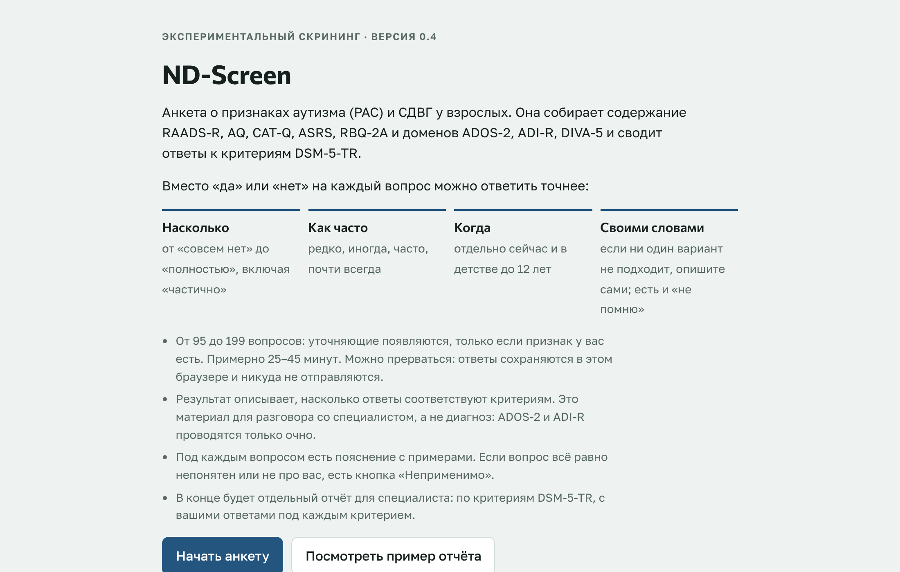
</p>

---

## Содержание

- [Зачем это нужно](#зачем-это-нужно)
- [Возможности](#возможности)
- [Новое в версии 0.11](#новое-в-версии-011)
- [Новое в версии 0.10](#новое-в-версии-010)
- [Чем ND-Screen отличается от исходных тестов](#чем-nd-screen-отличается-от-исходных-тестов)
- [Как устроена анкета](#как-устроена-анкета)
- [Форма ответа](#форма-ответа)
- [Как считаются баллы](#как-считаются-баллы)
- [На чём основаны веса](#на-чём-основаны-веса)
- [Отчёт](#отчёт)
- [Отчёт для специалиста](#отчёт-для-специалиста)
- [Проверка согласованности ответов](#проверка-согласованности-ответов)
- [Сильные стороны](#сильные-стороны)
- [Почему такой результат](#почему-такой-результат)
- [Настроение и тревога: PHQ-9 и GAD-7](#настроение-и-тревога-phq-9-и-gad-7)
- [Алекситимия: PAQ](#алекситимия-paq)
- [Аутистическое выгорание: ABSI](#аутистическое-выгорание-absi)
- [Сопутствующие состояния](#сопутствующие-состояния)
- [Что может помочь](#что-может-помочь)
- [Покрытие оригинальных тестов](#покрытие-оригинальных-тестов)
- [Ограничения](#ограничения)
- [Приватность](#приватность)
- [Устройство проекта](#устройство-проекта)
- [Источники](#источники)

---

## Зачем это нужно

Популярные скрининговые опросники для взрослых устроены так, что многим людям трудно ответить честно и точно:

- **Слишком узкие варианты ответа.** «Да / нет», «согласен / не согласен». Ответов «частично, но не всегда», «только на работе», «раньше было, сейчас нет» нет.
- **Настоящее и детство смешаны.** RAADS-R частично разделяет периоды, остальные тесты нет. А для диагноза и РАС, и СДВГ важно, было ли это в детстве.
- **Маскировка не учитывается.** Человек, который годами учился скрывать признаки, честно отвечает «нет, у меня это не видно» и получает низкий балл.
- **Каждый тест смотрит на свой кусок.** AQ не спрашивает про сенсорику так подробно, как RAADS-R; ASRS ничего не знает о РАС; CAT-Q измеряет только камуфляж. Картину приходится собирать вручную из пяти результатов.
- **Сумма баллов не равна критериям.** Высокий AQ не говорит, какие именно критерии DSM-5-TR выполнены, а какие нет.

ND-Screen решает это одной анкетой с расширенной формой ответа и подсчётом прямо по критериям DSM-5-TR.

---

## Возможности

| | |
|---|---|
| 🧩 **Одна анкета вместо семи** | Содержание RAADS-R, AQ, CAT-Q, ASRS, RBQ-2A, Aspie-quiz и домены ADOS-2, ADI-R, DIVA-5 |
| 🎚️ **Расширенная форма ответа** | 5 уровней + частота + «свой ответ» + «не помню» + где проявляется + видно ли со стороны + насколько мешает (с вариантом «не знаю») |
| 👶 **Детство отдельно** | На каждый вопрос два ответа: «сейчас» и «в детстве, до 12 лет» |
| 🎭 **Учёт маскировки** | Признак, который скрывается с усилием, получает поправку, а не теряется |
| 🔀 **Адаптивность** | 95 основных вопросов и до 104 уточняющих: они появляются, только если признак есть |
| 💡 **Пояснения** | Под каждым вопросом блок «Что имеется в виду» с бытовыми примерами |
| 📋 **Критерии DSM-5-TR** | РАС: A1–A3, B1–B4, C, D. СДВГ: 18 симптомов, B, C, D, тип проявления |
| 🔢 **Индекс 0–100** | По РАС и по СДВГ, плюс общий вывод: нейротипичный профиль, РАС, СДВГ, оба, отдельные черты |
| 📐 **Пересчёт в оригинальные шкалы** | RAADS-R, AQ, CAT-Q, RBQ-2A, ASRS (часть A и подшкалы), с порогами из публикаций |
| 🛡️ **Проверка согласованности** | 12 пар вопросов с противоположным смыслом, противоречия внутри ответа, сферы жизни, маскировка, скорость, однообразие |
| 🌧️ **PHQ-9 и GAD-7** | Валидированные шкалы депрессии и тревоги в оригинальной форме, с порогами и блоком экстренной помощи |
| 🫥 **Алекситимия (PAQ)** | Проверенная русская версия PAQ: трудно ли распознавать и описывать свои чувства, и что это значит для оценки общения |
| 🪫 **Аутистическое выгорание (ABSI)** | 20 вопросов о последнем периоде выгорания, 4 стороны выгорания по отдельности |
| 🩹 **Сопутствующие состояния** | 17 вопросов «да / нет» (сон, ЖКТ, гипермобильность, мигрень, мизофония, диспраксия, ОКР и другие) с частотой при РАС и СДВГ из исследований |
| ⚠️ **Дифференциальные флаги** | Тревога и депрессия (по PHQ-9 и GAD-7), алекситимия (по PAQ), социальная тревожность, последствия травмы, колебания настроения, недосып |
| ❓ **«Почему такой результат»** | У каждого критерия, симптома, уровня и индекса: какие ответы дали этот статус и чего не хватает до следующего |
| 🕸️ **Профиль-радар** | Все критерии РАС и группы симптомов СДВГ на одной картинке, сейчас и в детстве поверх друг друга |
| 🧭 **Что может помочь** | Методики и приспособления по выраженным признакам, у каждого уровень доказательности и источник |
| 🌱 **Сильные стороны** | 9 направлений с описанием, связью с РАС и СДВГ и ссылками на исследования, плюс карточка-картинка, чтобы поделиться |
| 🩺 **Отчёт для специалиста** | Критерии с ответами-основаниями, темы для интервью, следующие шаги; печать и копирование текстом |
| 🎨 **Пиксельные картинки** | 21 нарисованная сцена: у каждого раздела анкеты своя |
| ✏️ **Пример вопроса** | Перед анкетой можно потренироваться на вопросе «Я люблю сладкое» и увидеть, что значит каждый ответ |
| ⏳ **Машина времени** | Перед первыми вопросами о детстве 30 секунд, чтобы вспомнить себя в 7–10 лет; напоминания перед разделами |
| ☕ **Остановки между разделами** | После каждого раздела: сколько готово, сколько осталось по вашему темпу, можно сделать перерыв |
| 👪 **Раннее развитие и семья** | 7 вопросов о речи, потере навыков, специалистах, школе и диагнозах родственников; в баллы не входят |
| 🔋 **Бюджет энергии** | Что, судя по ответам, тратит силы и что восстанавливает, и черновик недели |
| 🎭 **Карта масок** | Где и что вы скрываете сильнее всего, по ответам «где проявляется» и «видно ли со стороны» |
| 🌌 **Темы оформления** | «Обычное», «Космос», «Поезда», «Океан»: все сцены перерисованы под тему, меняется и цвет кнопок |
| 🎞️ **Анимированные сцены** | Пар от чашки, часы, волны, поезд, дождь; можно выключить, при «уменьшить движение» выключено само |
| 🗺️ **Карта анкеты** | Разделы змейкой с прогрессом, переход к любому разделу, мини-карта на остановках |
| 🧑‍🎤 **Мой персонаж** | Пиксельный человечек под себя, предметы подсказаны ответами, без диагнозов на картинке, скачивание PNG |
| 🎵 **Тихая музыка** | Чиптюн в браузере, по умолчанию выключен, молчит в разделах о настроении и выгорании |
| 💭 **«Где были ваши мысли?»** | 6 коротких проб по ходу анкеты: на вопросе или в стороне, само или сознательно |
| ⏱️ **Лаборатория** | Необязательные задания на 2–3 минуты: «Сейчас или потом», «Ровно или волнами» (разброс времени реакции), «Тридцать секунд» (чувство времени), «Сколько вы замечаете» (ёмкость восприятия), «Лес или деревья» (целое и детали); в баллы не входят |
| 🔒 **Приватность** | Всё считается в браузере, ничего не отправляется на сервер |
| 📱 **Работает везде** | Телефон, планшет, компьютер, светлая и тёмная тема, печать в PDF |

---

## Новое в версии 0.12

Четыре новых задания в «Лаборатории», шкала вялого когнитивного темпа, черты вне DSM и три сопутствующих состояния, выбранные из [docs/ideas-5.md](docs/ideas-5.md) (идеи из базы знаний [neurodivergent_map](https://neurodivergentmap.vercel.app)). Как и раньше, они не входят в баллы, критерии, индексы и вывод: файлы подсчёта (`scoring.js`, `items.js`, `hints.js`) не менялись. Результаты есть в отчёте, в JSON и в отчёте для специалиста с пометкой «экспериментально». Норм для этих коротких заданий в браузере нет, поэтому отчёт описывает стиль, а не ставит оценку.

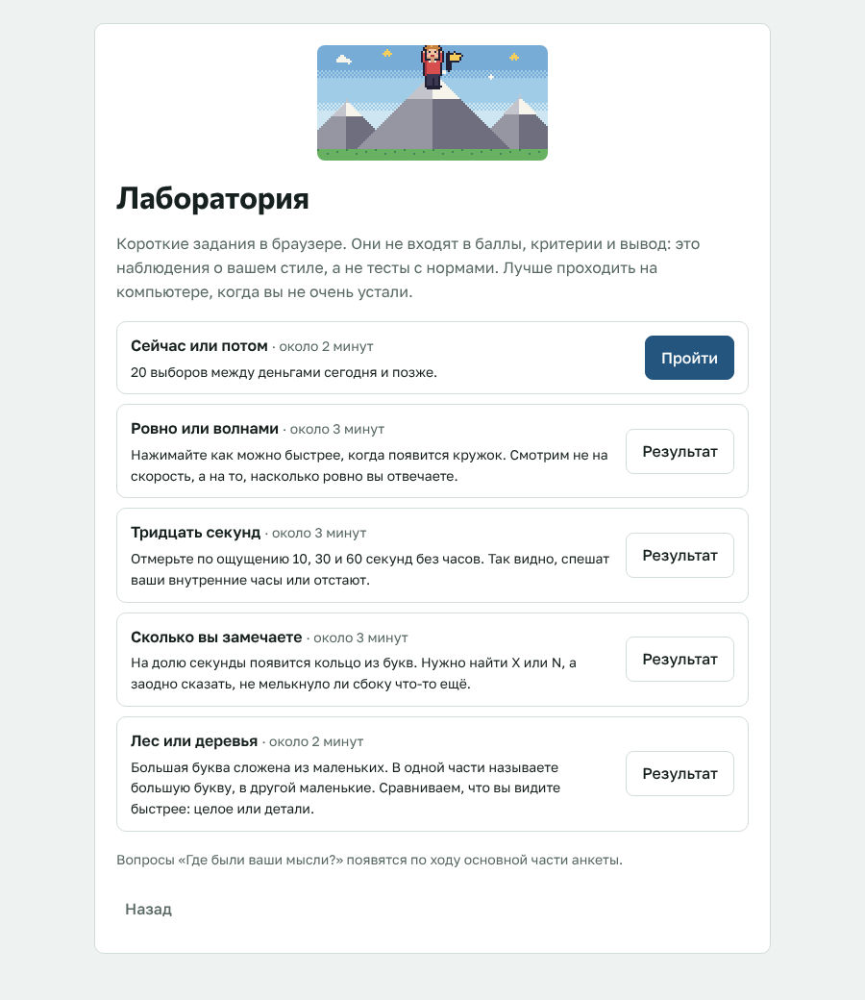

**«Ровно или волнами» (Б10).** Простая реакция: после случайной паузы 1–3 с появляется кружок, нужно нажать как можно быстрее. 3 тренировочные и 50 настоящих попыток. Главный показатель не скорость, а разброс: коэффициент вариации (стандартное отклонение / среднее), число очень медленных ответов (вдвое дольше медианы), разброс в первой и второй половине. Нажатия раньше сигнала, ответы быстрее 150 мс и пропуски (дольше 1,5 с) не засчитываются. Повышенная изменчивость времени реакции — один из самых устойчивых лабораторных признаков СДВГ (метаанализ 319 исследований, Kofler et al., 2013; у взрослых различие меньше, чем у детей).

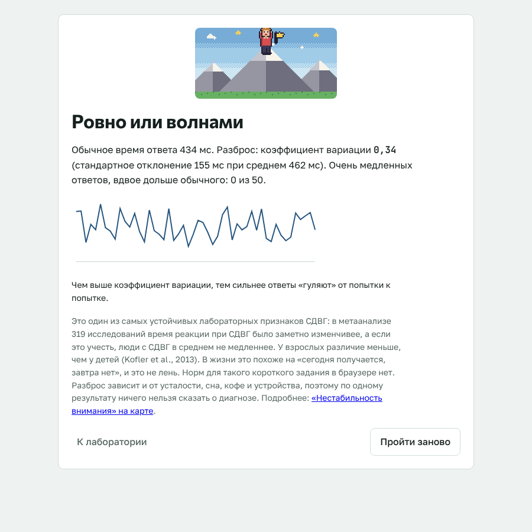

**«Тридцать секунд» (Б11).** Нажать «Старт», затем «Стоп», когда, по ощущению, прошло 10, 30, 60, 30 и 10 секунд, без часов. Итог: отношение отмеренного к нужному (среднее геометрическое, чтобы «вдвое дольше» и «вдвое короче» весили одинаково), средняя ошибка и различие повторов. В конце вопрос, считал ли человек про себя. Основание: у людей с СДВГ ниже точность отмеривания и оценки интервалов, авторы говорят об «ускоренных внутренних часах» (метаанализ Marx et al., 2021; у детей и подростков Zheng et al., 2022).

**«Сколько вы замечаете» (Б12).** По образцу задач на перцептивную нагрузку Нилли Лави: на 0,1 с вокруг крестика появляется кольцо из 6 букв, нужно назвать X или N. При низкой нагрузке остальные позиции — кружочки «o», при высокой — другие угловатые буквы. В половине попыток сбоку мелькает серый квадрат, после каждой попытки спрашивается, был ли он. 4 тренировочные и 32 настоящие попытки. Итог: доля замеченных квадратов при лёгком и трудном поиске за вычетом ложных «видел». У типичных взрослых при высокой нагрузке лишнее замечается реже, у аутичных нагрузка на это почти не влияла (Remington, Swettenham & Lavie, 2012; у детей Swettenham et al., 2014). Если квадрат часто «виделся», когда его не было, если буква угадывалась случайно или квадрат не замечался и при лёгком поиске, вывод не делается.

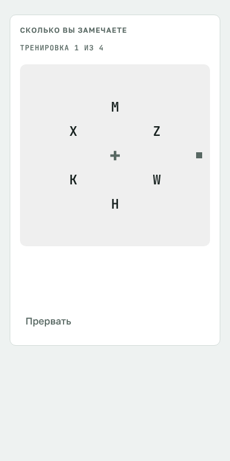

**«Лес или деревья» (Б13).** Фигуры Навона (Navon, 1977): большая буква Н или С из маленьких Н или С. В одной части называется большая буква, в другой маленькие, порядок частей случайный, в каждой 4 тренировочные и 16 настоящих попыток. Итог: медианы времени, что быстрее (целое или детали) и насколько несовпадающие буквы мешают. Метаанализ van der Hallen et al. (2015) не нашёл при аутизме ни общего преимущества в деталях, ни «неспособности видеть целое», но целое замечалось немного позже, поэтому результат подписан как стиль.

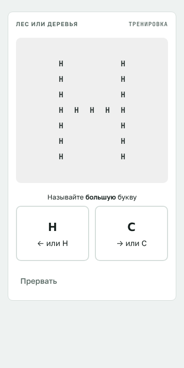

Если вкладку свернуть во время задания, оно прерывается: браузер замедляет таймеры, и время было бы искажено.

**Вялый когнитивный темп: ACI (Б6).** Новый раздел из 10 вопросов Adult Concentration Inventory (Becker et al., 2018; структура у взрослых подтверждена в Fredrick et al., 2021): мечтательность, «туман», медленные мысли, «зависания», за последние 6 месяцев, ответы 0–3. Балл — среднее, порогов нет, поэтому отчёт сравнивает со средним в общей выборке взрослых США (0,53 ± 0,49). В метаанализе эти черты выделялись в отдельную от СДВГ группу (Becker et al., 2016). Перевод наш, неофициальный. Как и PAQ и ABSI, шкала не влияет на РАС и СДВГ.

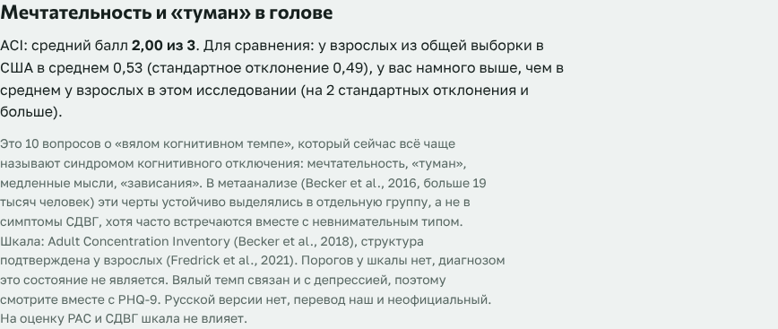

**Черты, о которых часто говорят (Б7).** Раздел из 5 вопросов «нет / отчасти / да»: аутичная инерция, чувствительность к несправедливости, чувствительность к отвержению (RSD), избегание требований (похоже на PDA), гиперфокус. «Слепота ко времени» отдельно не спрашивается, она берётся из уже заданных вопросов о времени (EX-3, H1-e2). У каждой черты в отчёте значок доказательности по базе знаний (мало данных, умеренные данные, спорно), что о ней известно с источниками, что может помочь и ссылка на статью карты. Если инерция отмечена, а PHQ-9 не меньше 10, задаётся уточнение: «хочется, но не получается начать» или «ничего не хочется», чтобы отличить инерцию от потери желания при сниженном настроении.

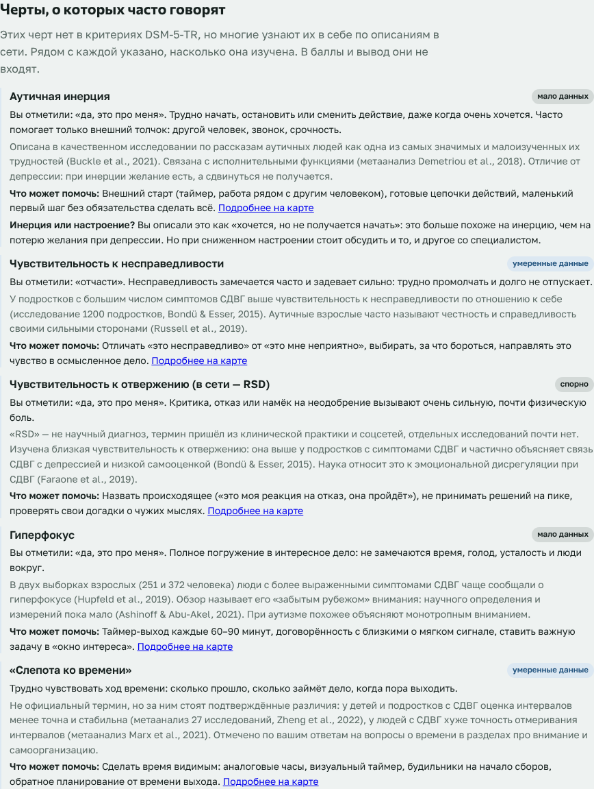

**Ещё три сопутствующих состояния (Б9):** мизофония (Swedo et al., 2022; Williams et al., 2021), диспраксия (Fournier et al., 2010; Lingam et al., 2009), ОКР (Lai et al., 2019; Hirschtritt et al., 2015).


### Выводы по заданиям (0.12.1)

У каждого задания лаборатории на экране результата теперь есть блок «Вывод»: короткий итог одной фразой, что это значит в жизни, связь с исследованиями и 1–3 совета, что может помочь. Тот же итог виден на карточке задания в лаборатории и одной строкой в отчёте для специалиста. Норм для этих заданий нет, поэтому границы между уровнями — наш ориентир для чтения результата, а не клиническая норма; это написано под каждым выводом.

| Задание | Что показывает вывод | Ориентир |
|---|---|---|
| Мысли (пробы) | доля ответов «мысли были не о деле» | меньше 30% / 30–60% / больше 60% (в среднем около 47%, Killingsworth & Gilbert, 2010) |
| Сейчас или потом | площадь под кривой обесценивания | 0,7 и выше / 0,4–0,7 / ниже 0,4 |
| Ровно или волнами | коэффициент вариации времени реакции | меньше 0,2 / 0,2–0,3 / 0,3 и выше |
| Тридцать секунд | средняя ошибка отмеривания | меньше 15% / 15–30% / 30% и больше |
| Сколько вы замечаете | «большой запас восприятия» или «обычный фильтр внимания» | стиль, не уровень |
| Лес или деревья | что быстрее, целое или детали | разница больше 30 мс в одну из сторон |

Если данных мало или ответы ненадёжны (много ложных «видел», угадывание, мало засчитанных попыток), вывод прямо говорит, что его сделать нельзя, и предлагает пройти задание ещё раз. Баллы РАС и СДВГ не меняются.

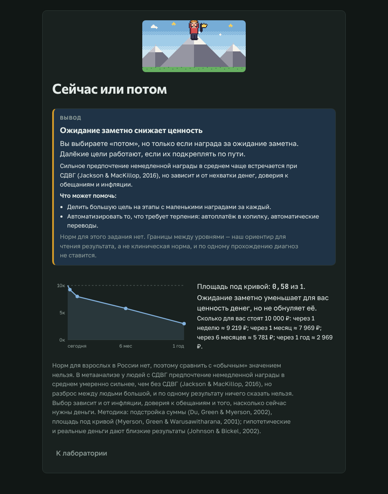

### Доп. вопросы только там, где они уместны (0.12.2)

Каждый пункт проверен на то, подходят ли к нему «Как часто», «Где проявляется», «Видно ли это со стороны?», «Насколько это мешает сейчас?» и колонка «В детстве». Полный разбор: [docs/followups-audit.md](docs/followups-audit.md).

- «Где проявляется» больше не спрашивается у 22 пунктов о вкусах, интересах, фактах о себе и периодах выгорания. В вопросах об общении нет варианта «Наедине с собой».
- «Насколько это мешает» убрано у 19 нейтральных черт и того, что помогает (замечать детали, глубокие интересы, движения для успокоения).
- «Видно ли со стороны» убрано ещё у 7 пунктов, «Как часто» ещё у 4 сравнительных черт, колонка «В детстве» ещё у 3 взрослых ситуаций.
- В колонке «Сейчас» кнопка «Не знаю» вместо «Не помню», у вопросов о сферах жизни «Не мешают». У сопутствующих состояний есть «Не знаю». В вопросах о первых словах и фразах нет пропуска в возрастах.

Баллы при этом сдвигаются немного: на 1006 профилях индекс РАС меняется от −1 до +2 (в среднем на 0,5), СДВГ на −1 у 9% профилей, вывод у 1,6% пограничных профилей.

## Новое в версии 0.11

Как и раньше, ничто из этого не меняет баллы, критерии DSM-5-TR, индексы и проверку согласованности. Файлы подсчёта (`scoring.js`, `items.js`, `hints.js`) не менялись; сравнение со старой версией на 400 случайных профилях и примере отчёта даёт 0 различий.

**Темы оформления.** На главной можно выбрать «Обычное», «Космос», «Поезда» или «Океан». Все 21 сцена перерисованы под каждую тему: в «Космосе» звёзды и планета за окном, в «Поездах» по горизонту едет состав, в «Океане» море с парусником и песок вместо пола. Тема меняет и цвет кнопок, в светлом и тёмном режиме.

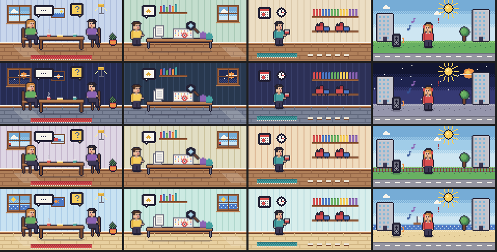

**Анимированные сцены.** У картинок 4 кадра: идёт пар от чашки, двигается стрелка часов, мигает уведомление, плывут волны, едет поезд, падают капли дождя. Поверх картинки кладётся прозрачная полоса только из меняющихся пикселей, поэтому все темы с анимацией весят около 210 КБ. Анимацию можно выключить, а при системной настройке «уменьшить движение» её нет.

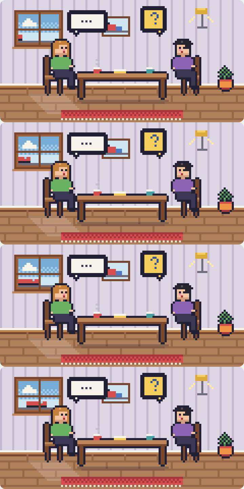

**Карта-путешествие.** Разделы анкеты разложены змейкой с пунктирной дорожкой: пройденные отмечены галочкой, текущий выделен, на нём стоит ваш персонаж. На любой раздел можно нажать и перейти к его первому вопросу без ответа. Маленькая карта есть на экранах между разделами.

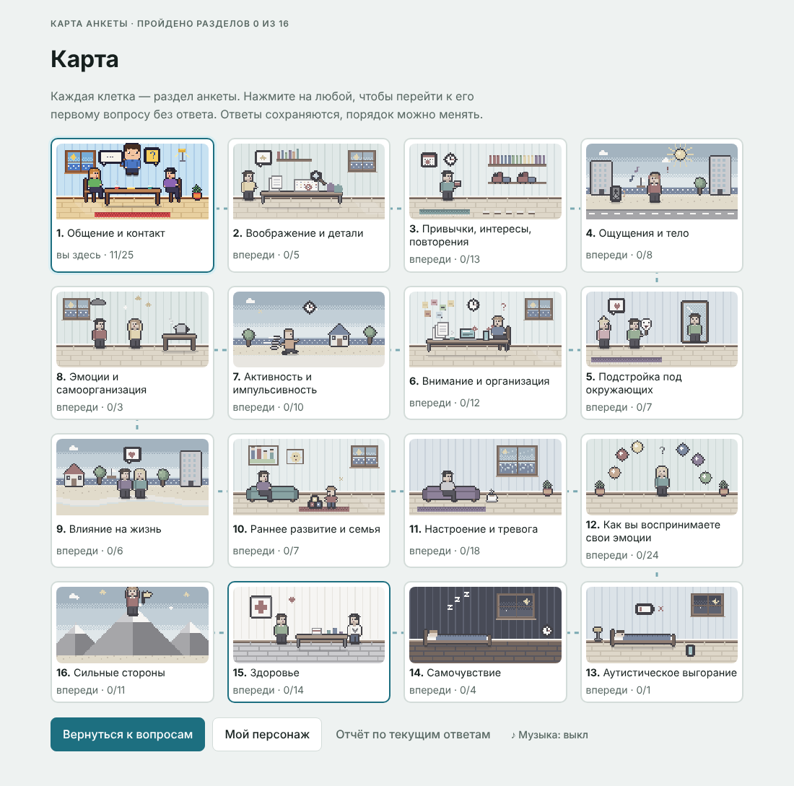

**Мой персонаж.** Пиксельный человечек 32×32: кожа, цвет волос, причёска, одежда и предметы. Предметы подсказаны ответами (наушники при чувствительности к звукам, стикеры при трудностях с организацией, книги при глубоких увлечениях, лупа, искры идей, маска), но их можно снять или добавить свои: очки, кот. Слов «РАС» и «СДВГ» на картинке нет, её можно скачать.

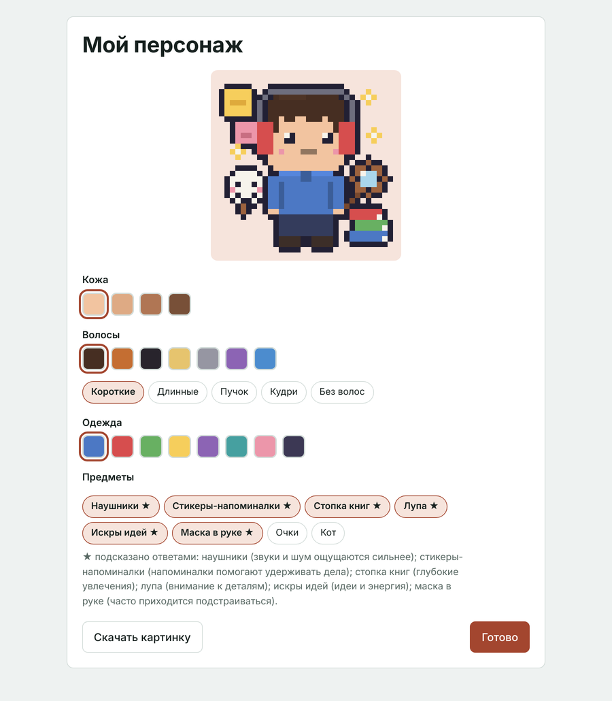

**Тихая музыка.** Чиптюн из браузера (Web Audio), у каждого раздела своя короткая пентатоническая петля, громкость регулируется. По умолчанию выключена и сама замолкает в разделах PHQ-9, GAD-7 и ABSI.

**«Где были ваши мысли?»** Шесть раз за основную часть анкеты, в случайный момент внутри раздела (не на границе), появляется вопрос: на вопросе, о другом, пусто в голове, не могу сказать. Если «о другом», уточняется, само это вышло или сознательно. В отчёте: доля проверок, когда мысли были не на вопросе, и разница между первой и второй половиной анкеты. Для ориентира приведены 47% из исследования с такими пробами в обычной жизни (Killingsworth & Gilbert, 2010) и связь непроизвольного, но не намеренного блуждания мыслей с признаками СДВГ (Seli et al., 2015). Вопросы можно отключить.

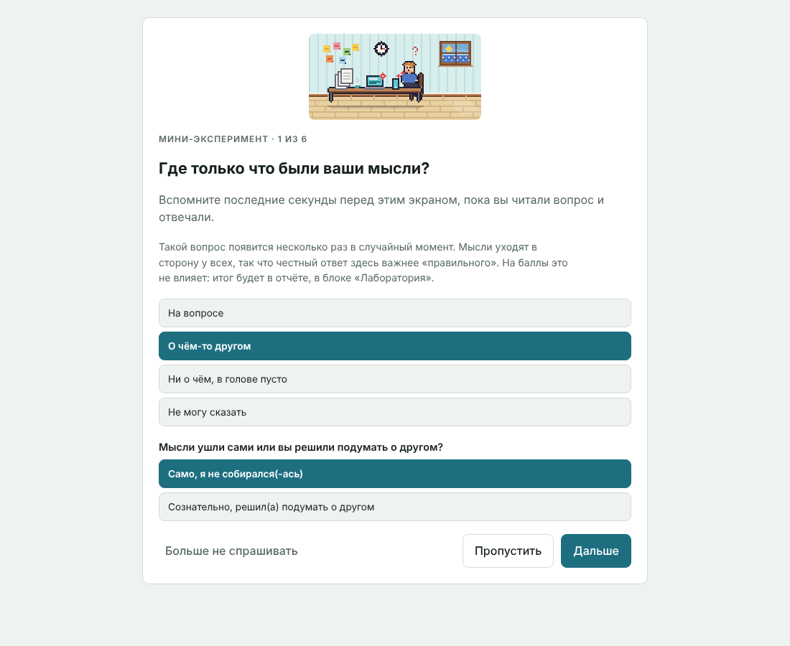

**Лаборатория: «Сейчас или потом».** Необязательное задание после отчёта: 20 выборов между суммой сегодня и 10 000 ₽ через неделю, месяц, полгода и год. Сумма «сегодня» подстраивается (Du, Green & Myerson, 2002), итог — точки безразличия, график и площадь под кривой (Myerson et al., 2001). Непоследовательные ответы отмечаются по критерию Johnson & Bickel (2008). Норм для России нет, поэтому отчёт не сравнивает с «нормой» и только упоминает, что при СДВГ предпочтение «сейчас» в среднем умеренно сильнее (метаанализ Jackson & MacKillop, 2016). Результаты лаборатории есть в отчёте, в JSON и в отчёте для специалиста с пометкой «экспериментально».

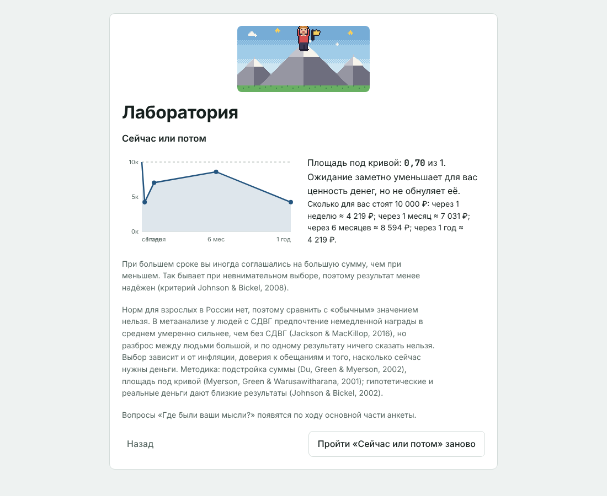

---

## Новое в версии 0.10

Ничто из этого не меняет баллы, критерии DSM-5-TR, индексы и проверку согласованности. Это проверено тестом на 150 случайных профилях и сравнением со старой версией на 400 профилях и примере отчёта.

**Пиксельные картинки.** 21 сцена размером 120×60 пикселей с контуром, тенями и светом из окна: кафе, рабочий стол со стикерами, шумная улица, зеркало и маска, класс со школьной доской, вершина горы и другие. У каждого раздела анкеты своя сцена, отдельные картинки есть у примера вопроса, «машины времени», бюджета энергии и карты масок. Картинки рисует скрипт `tools/pixelart.py`, он же складывает их в `src/pixels.js` (около 38 КБ), поэтому сайт не загружает отдельных файлов.

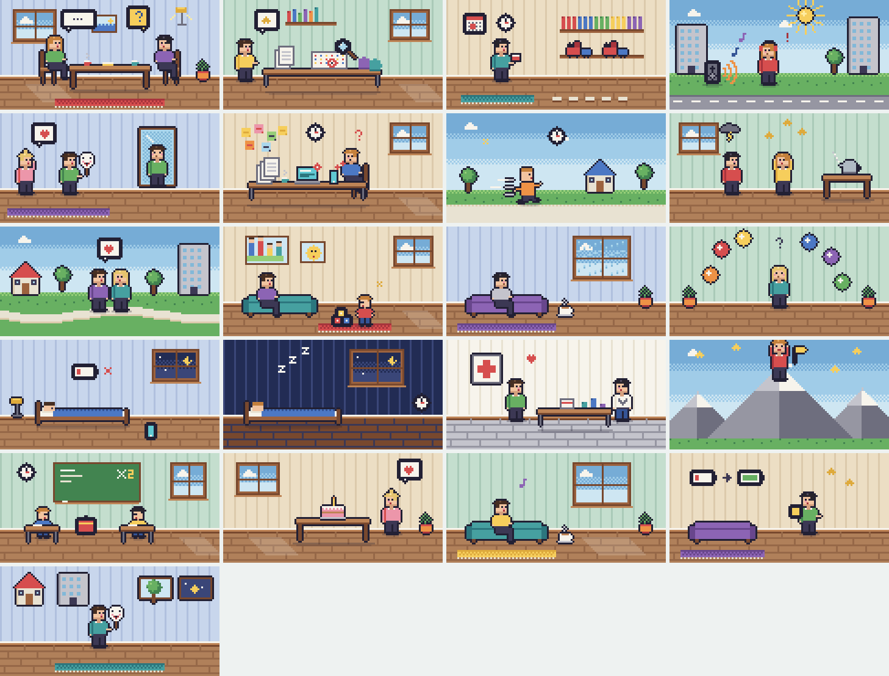

**Пример вопроса.** При первом запуске перед анкетой показывается тренировочный вопрос «Я люблю сладкое» со всеми полями. Под ним сразу объясняется, что значит выбранный ответ. Ответ никуда не сохраняется. Пример можно открыть и потом, кнопкой «Как отвечать» на главной.

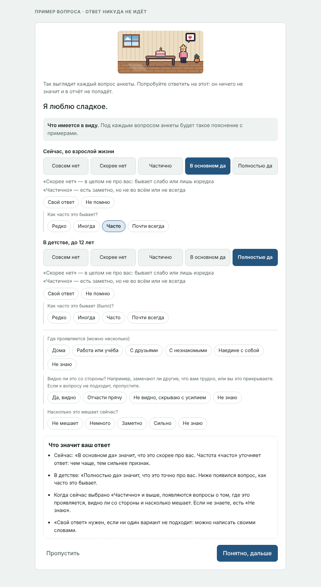

**Машина времени.** Перед первым вопросом экран на 30 секунд: вспомнить школу, учителя, перемены, свою комнату. Воспоминания точнее, если сначала мысленно вернуться в обстановку (метод календаря жизни, Belli, 1998; восстановление контекста в когнитивном интервью, Fisher & Geiselman, 1992). Перед каждым разделом с вопросами о детстве есть короткая подсказка под тему раздела.

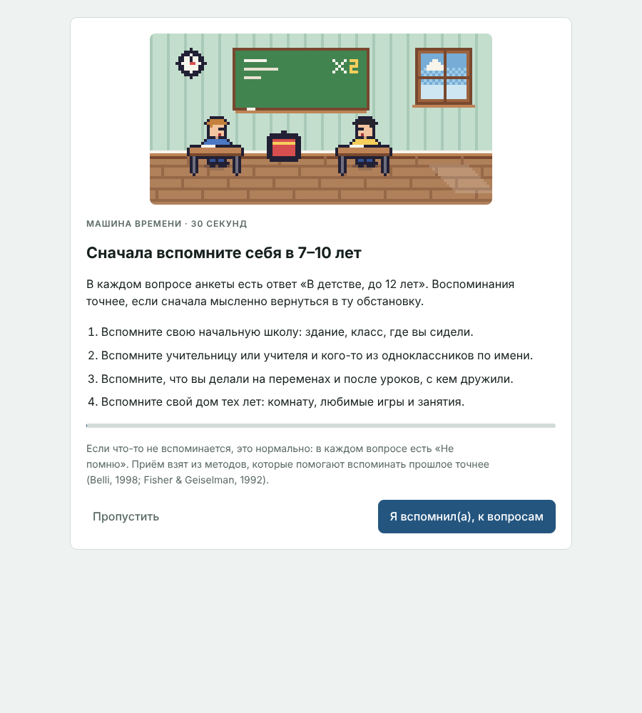

**Остановки между разделами.** После каждого раздела показывается экран: сколько разделов готово, сколько минут осталось по вашему темпу (медиана времени ваших ответов) и кнопка «Сделать перерыв». Ответы сохранены, анкета продолжится с того же места. Экран показывается один раз на раздел.

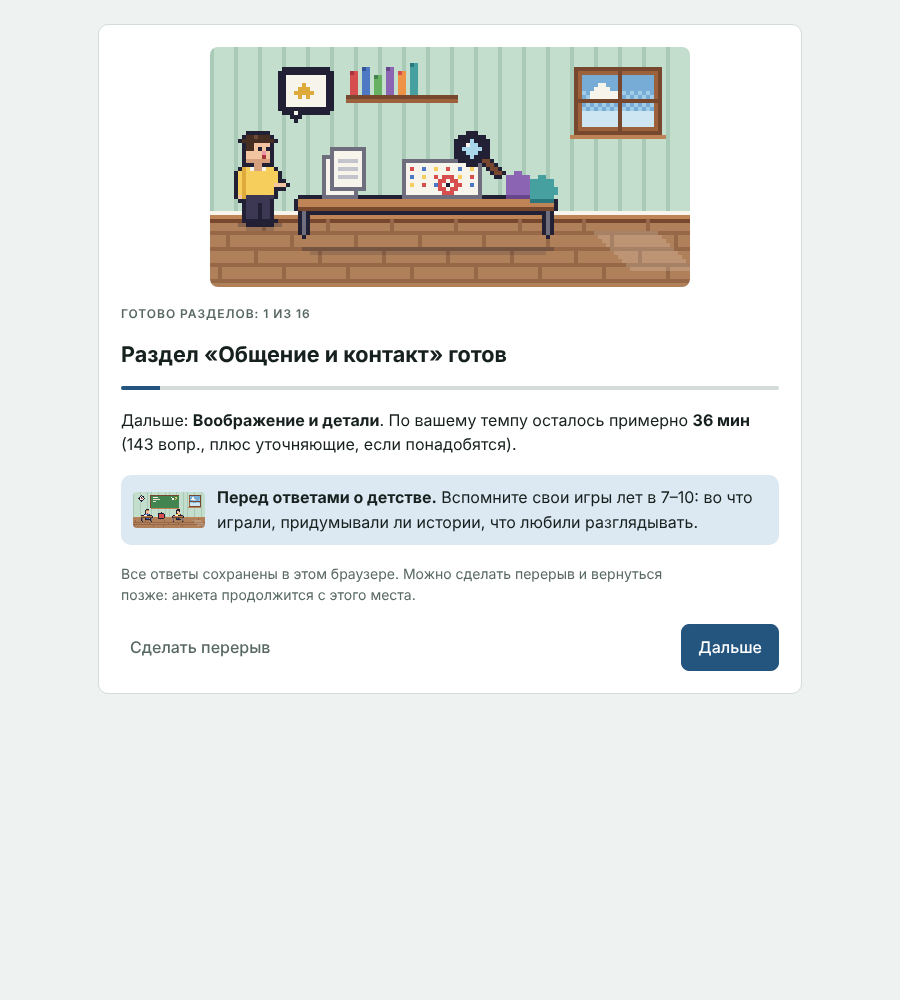

**Раннее развитие и семья.** Новый раздел из 7 вопросов: первые слова и фразы, потеря освоенных навыков, специалисты в детстве, что говорили учителя, диагнозы у родственников первой линии, похожие черты у родственников без диагноза. У каждого вопроса есть «Не знаю». В отчёте ответы идут таблицей, а значимые ответы получают пояснение с источником: задержка речи в ADI-R (Lord et al., 1994), регресс у трети детей с РАС (Barger et al., 2013), школьные характеристики в DIVA-5 (Kooij et al., 2019), наследуемость СДВГ и РАС (Faraone & Larsson, 2019; Bai et al., 2019), риск при биполярном расстройстве у родственников (Smoller & Finn, 2003) и другие. Раздел есть и в отчёте для специалиста.

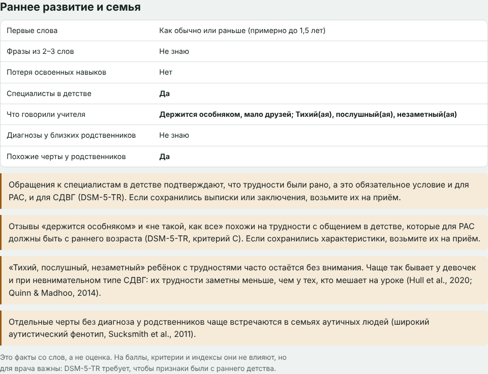

**Бюджет энергии.** По выраженности признаков «сейчас» отчёт показывает, что, вероятно, тратит силы: общение, маскировка, сенсорика, перемены, скучные дела, необходимость сидеть на месте. Рядом показано, что может восстанавливать: интересы, тишина, люди, с которыми не нужно притворяться, движение, распорядок, новизна. У каждого пункта указан уровень доказательности и источник, а если исследований нет, так и написано. Внизу черновик недели, где тяжёлые дни чередуются с лёгкими. Сферы выше порога 40 считаются выраженными.

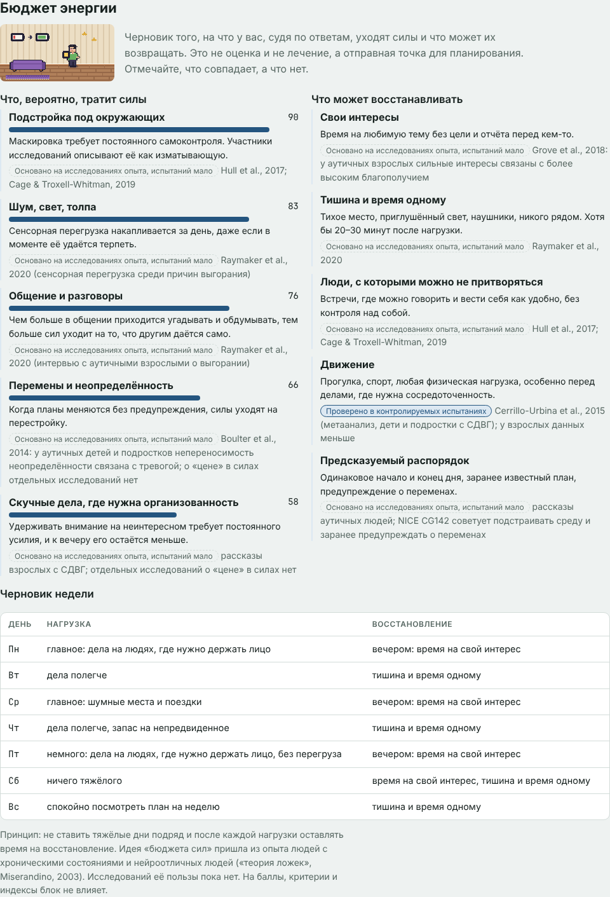

**Карта масок.** Строится из ответов «где проявляется» и «видно ли это со стороны» по признакам РАС и СДВГ, где сейчас «частично» и выше. Показывает, в какой обстановке (работа, незнакомые, друзья, дом) и в какой сфере (общение, интересы, ощущения, внимание, активность) вы скрываете больше всего, и какие признаки скрываете с усилием. Если разница между местами меньше 10 пунктов, карта честно пишет, что скрываете везде одинаково. Видимость спрашивается про признак в целом, а не про каждое место, поэтому карта приблизительная.

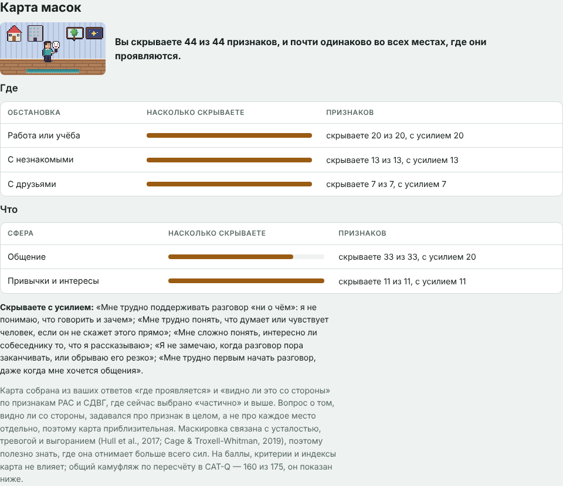

---

## Чем ND-Screen отличается от исходных тестов

| Инструмент | Что измеряет | Ограничение для взрослого самоотчёта | Что добавляет ND-Screen |
|---|---|---|---|
| **RAADS-R** (80 вопросов) | РАС: социальность, интересы, язык, сенсомоторика | 4 варианта ответа; детство до 16 лет только в виде «верно только в юности»; частоты нет | 5 уровней и частота для обоих периодов; подшкалы пересчитываются по оригинальному правилу 3/2/1/0 |
| **AQ** (50 вопросов) | Аутистические черты в 5 доменах | Только согласие, без частоты и без детства; ответы сводятся к 0/1 | Частота, детство, контекст; пересчёт в AQ с порогами 26 и 32 |
| **CAT-Q** (25 вопросов) | Камуфляж: компенсация, маскировка, ассимиляция | Измеряет только камуфляж, не связан с другими признаками | Камуфляж входит в балл каждого признака как поправка + отдельная шкала CAT-Q |
| **ASRS v1.1** (18 вопросов) | Симптомы СДВГ по частоте | Только «сейчас», детство (критерий B) не спрашивается; нет связи с РАС | Детство отдельно, критерии B–D, вес части A, РАС в той же анкете |
| **RBQ-2A** (20 вопросов) | Повторяющееся поведение, настаивание на неизменности | Только этот домен | Входит в B1/B2 вместе с остальными источниками |
| **Aspie-quiz** | Широкий профиль нейроотличных черт и талантов | Не валидирован | Используются только темы: для сильных сторон и для полноты вопросов; в баллы не идёт |
| **ADOS-2** | Наблюдение специалистом | Невозможен в самоотчёте | Его домены (взаимность, невербальное общение, стереотипии) задают структуру вопросов; в отчёте для специалиста он указан как следующий шаг |
| **ADI-R** | Интервью с родителем о развитии | Нужен информант и обученный специалист | Его логика «как было в 4–5 лет / до 12» — в каждом вопросе о детстве; темы для интервью собираются автоматически |
| **DIVA-5** | Структурированное интервью по СДВГ | Нужен специалист | Порог детства DIVA-5 (6 симптомов) показан в отчёте наравне с DSM (3 симптома) |

**Главное отличие:** исходные тесты дают по одной сумме баллов. ND-Screen показывает, *какие именно* критерии DSM-5-TR выполнены, на каких ответах это держится, было ли это в детстве, скрывается ли, мешает ли, и насколько ответы согласованы между собой.

---

## Как устроена анкета

**274 вопроса:** 150 основных, которые видит каждый, 104 уточняющих и 20 вопросов о выгорании, которые открываются, только если выгорание было. Уточняющий вопрос открывается, только если на основной вопрос той же темы ответ «частично» или выше, сейчас или в детстве. Человек без признака не тратит время на 15 уточнений о нём, а у человека с признаком картина получается подробнее.

| Раздел | Всего | Основных | Что покрывает |
|---|---:|---:|---|
| Общение и контакт | 40 | 14 | DSM A1–A3: взаимность, невербальное общение, отношения |
| Воображение и детали | 14 | 5 | AQ «Воображение», «Внимание к деталям» |
| Привычки, интересы, повторения | 36 | 13 | DSM B1–B3, RBQ-2A |
| Ощущения и тело | 17 | 8 | DSM B4, моторика, интероцепция |
| Подстройка под окружающих | 21 | 7 | Камуфляж (CAT-Q), истощение после общения |
| Внимание и организация | 21 | 12 | СДВГ A1: 9 симптомов невнимательности |
| Активность и импульсивность | 19 | 10 | СДВГ A2: 9 симптомов гиперактивности и импульсивности |
| Эмоции и самоорганизация | 7 | 3 | Эмоциональная регуляция, чувство времени, гиперфокус |
| Влияние на жизнь | 7 | 6 | 5 сфер жизни (критерий D) и выгорание |
| Настроение и тревога | 18 | 18 | PHQ-9 и GAD-7 в оригинальной форме, за последние 2 недели |
| Восприятие своих эмоций | 24 | 24 | Алекситимия, PAQ (русская версия) |
| Аутистическое выгорание | 21 | 1 | Вход «было ли выгорание» и 20 вопросов ABSI |
| Мечтательность и «туман» | 10 | 10 | Вялый когнитивный темп, 10 пунктов ACI (неофициальный перевод) |
| Черты, о которых часто говорят | 6 | 5 | Инерция, несправедливость, отвержение, избегание требований, гиперфокус; уточнение «инерция или настроение» |
| Самочувствие | 4 | 4 | Дифференциальные флаги: социальная тревожность, травма, колебания настроения, сон |
| Здоровье | 17 | 17 | Сопутствующие состояния, «да / нет» |
| Сильные стороны | 11 | 11 | 9 направлений |

Внутри разделов: 12 вопросов с противоположным смыслом для проверки согласованности, по 2 вопроса на каждый из 18 симптомов СДВГ, от 9 до 21 вопроса на каждый критерий РАС.

Формулировки собственные: оригинальные тесты защищены авторским правом, а вопросы ND-Screen написаны заново по смыслу тех же конструктов. Каждый вопрос помечен тегами подшкал оригиналов (`src: "RAADS.soc AQ.soc"`), по которым идёт пересчёт.

---

## Форма ответа

<p align="center">
  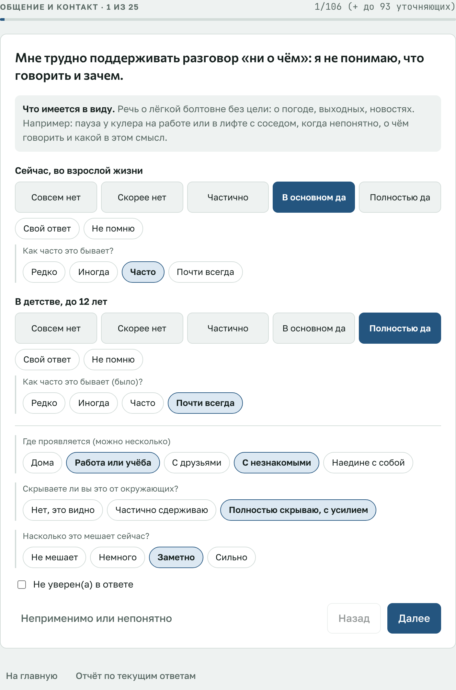
  &nbsp;&nbsp;
  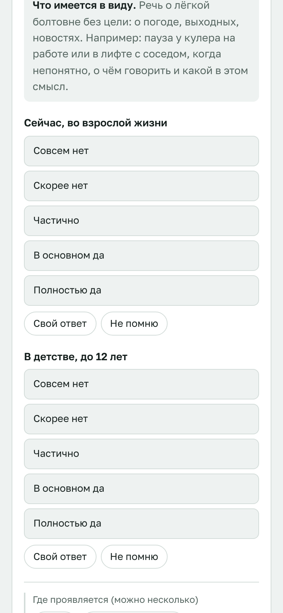
</p>

Все поля видны сразу, ничего не надо раскрывать. Поля «где проявляется», «видно ли со стороны» и «насколько мешает» появляются, только если сейчас выбрано хотя бы «частично»: при «совсем нет» и «скорее нет» спрашивать об этом бессмысленно. В каждом из этих полей есть «Не знаю».

**Что значат средние варианты.** «Скорее нет» значит, что это в целом не про вас: бывает слабо или лишь изредка. «Частично» значит, что это есть заметно, но не во всём или не всегда. Пояснение показано под шкалой и во вступлении.

| Поле | Варианты | Куда идёт |
|---|---|---|
| **Насколько** (отдельно сейчас и в детстве; у 4 вопросов о взрослых ситуациях, например о флирте, только сейчас) | Совсем нет · Скорее нет · Частично · В основном да · Полностью да | Балл вопроса |
| **Как часто** (появляется при «частично» и выше; у 14 вопросов об устойчивых чертах и предпочтениях, например «мои интересы держатся годами», не спрашивается, и балл равен уровню) | Редко · Иногда · Часто · Почти всегда | Балл вопроса; для СДВГ «часто» обязательно, как в DSM |
| **Свой ответ** | Свободный текст | В отчёт и отчёт для специалиста; если выбран и уровень, считается уровень |
| **Не помню** | Для любого периода | Вопрос за этот период не учитывается (не обнуляется) |
| **Где проявляется** (при «частично» и выше) | Дома · Работа или учёба · С друзьями · С незнакомыми · Наедине с собой · Не знаю | Критерий C СДВГ (две и более обстановки), проверка противоречий |
| **Видно ли со стороны** (при «частично» и выше) | Да, видно · Отчасти прячу · Не видно, скрываю с усилием · Не знаю | Поправка на маскировку к баллу «сейчас». Поля нет у 48 вопросов: вопросы о самой маскировке (CM-1…CM-20), о внутреннем восприятии или занятиях наедине, где скрывать нечего, и вопросы вида «Мне говорят…», где это по определению видно (список в `ND.NO_MASK`) |
| **Насколько мешает сейчас** (при «частично» и выше) | Не мешает · Немного · Заметно · Сильно · Не знаю | Критерий D и индексы. «Не знаю» = нет ответа |
| **Неприменимо или непонятно** | Кнопка | Вопрос исключается из подсчёта |

---

## Как считаются баллы

Подсчёт идёт по слоям: от одного ответа к критерию, от критериев к выводу. Все функции чистые и лежат в [`src/scoring.js`](src/scoring.js).

### L1. Балл вопроса (0–1)

```
I  = уровень / 4                      0, 0.25, 0.5, 0.75, 1
F  = частота: редко 0.25 · иногда 0.5 · часто 0.75 · почти всегда 1
     (если частота не выбрана: 0.5 при «частично» и выше, 0.2 ниже)
s  = I × (0.5 + 0.5 × F)
```

Частота может снизить балл максимум вдвое, но не обнулить его: «полностью да, но редко» — это всё равно признак. Примеры: «в основном да, часто» = 0.66; «полностью да, почти всегда» = 1; «частично, иногда» = 0.38.

**Маскировка** (только для «сейчас»):

```
s' = s + 0.5 × (маскировка / 2) × (1 − s) × I
```

Поправка заполняет часть оставшегося до 1 расстояния и пропорциональна силе признака. Она применяется только при «частично» и выше, потому что ниже вопрос «видно ли со стороны» не задаётся; при «не знаю» поправки нет. Логика взята из CAT-Q и исследований камуфляжа: замаскированный признак всё равно есть, просто окружающие его не видят.

### L2. Критерий или симптом

Балл критерия равен среднему по открытым вопросам этого критерия, но не ниже среднего по основным вопросам. Уточняющие вопросы открываются только после ответа «частично» и выше и описывают отдельные, часто более редкие примеры признака. Если бы они могли тянуть балл вниз, человек, которому они открылись, получал бы меньше того, кому не открылись: «полностью да» на основной вопрос и «нет» на уточняющий давали бы половину балла. Поэтому уточняющие вопросы могут поднять балл, но не опустить его ниже основных. Статус определяется по баллу:

| Статус | Условие |
|---|---|
| **выполнен** | балл ≥ 0.6 |
| **вероятно** | балл ≥ 0.4 |
| **нет** | балл < 0.4 |
| **нет данных** | отвечено меньше половины основных вопросов |

Для симптома СДВГ «выполнен» дополнительно требует частоты «часто» или «почти всегда» хотя бы в одном вопросе: в DSM-5-TR каждый симптом формулируется как «часто…».

### L3. Критерии DSM-5-TR

**РАС**
- **Ядро:** выполнены все три A (A1–A3) и не меньше двух из четырёх B (B1–B4).
- **C, раннее начало:** «выполнен» при ≥ 3 критериях в детстве на уровне «вероятно» и выше.
- **D, нарушения:** (сферы жизни и выгорание засчитываются, только если у РАС есть хоть какие-то признаки) «мешает заметно» хотя бы в одной сфере жизни, или выгорание ≥ 0.6, или ≥ 3 признаков с ответом «мешает заметно/сильно».
- **E** (интеллект, задержка развития) анкетой не оценивается, это отмечено в отчёте.

**СДВГ**
- **A:** ≥ 5 из 9 симптомов в группе невнимательности или в группе гиперактивности-импульсивности (порог для 17+ лет).
- **B:** ≥ 3 симптомов до 12 лет («несколько», DSM). Порог DIVA-5 (6) показан отдельно.
- **C:** две и более обстановки по полю «где проявляется» или две сферы жизни с «мешает заметно» и выше. «Наедине с собой» отдельной обстановкой не считается.
- **D:** как у РАС, по сферам жизни и ответам «мешает».
- **Тип проявления:** комбинированный, преимущественно невнимательный, преимущественно гиперактивно-импульсивный.

### L4. Уровень, индекс, общий вывод

**Уровень соответствия** по каждому направлению:

| Уровень | Условие |
|---|---|
| Высокое соответствие | ядро и все остальные критерии «выполнен», и в ответах нет существенных противоречий |
| Соответствие под вопросом | все критерии «выполнен», но в ответах много противоречий |
| Частичное соответствие | ядро и остальные критерии хотя бы «вероятно» |
| Отдельные черты | хотя бы один критерий РАС «вероятно» или 3+ симптома СДВГ «вероятно» |
| Не соответствует | всё ниже |

**Индекс РАС (0–100):**

```
ядро(период) = (0.45 × среднее A1–A3 + 0.30 × среднее двух сильнейших B) / 0.75
индекс = 0.75 × ядро(сейчас) + 0.10 × нарушения + 0.15 × ядро(детство)
нарушения = max(сферы жизни / 3, выгорание, среднее «мешает» по признакам РАС) × min(1, ядро(сейчас) / 0.6)
```

**Индекс СДВГ (0–100):**

```
ядро(период) = 0.7 × max(5 сильнейших A1, 5 сильнейших A2) + 0.3 × среднее 6 симптомов части A ASRS
индекс = 0.6 × ядро(сейчас) + 0.2 × нарушения + 0.2 × ядро(детство)
нарушения = max(сферы жизни / 3, среднее «мешает» по симптомам СДВГ) × min(1, ядро(сейчас) / 0.6)
```

Нарушения входят в индекс в той мере, в какой есть сами признаки: по DSM-5-TR трудности должны быть вызваны симптомами. Множитель `min(1, ядро / 0.6)` равен 1, когда ядро дошло до порога «выполнен», и уменьшается вместе с ядром. Без него человек без признаков, но с тяжёлой депрессией получал 10 баллов индекса РАС и 20 баллов индекса СДВГ только за нарушения.

Если про детство данных нет, его доля перераспределяется на остальные части. Если обязательное условие DSM явно не выполнено (начало в детстве: C для РАС, B для СДВГ; или влияние на жизнь, D), индекс не поднимается выше 49. Значение без ограничения показывается рядом. Тип проявления СДВГ указывается только при начале в детстве. Диапазоны индекса совпадают с порогами критериев: < 40 низкий (ниже уровня «вероятно»), 40–59 умеренный (уровень «вероятно»), 60–79 выраженный (уровень «выполнен»), ≥ 80 высокий.

**Общий вывод** складывается из двух уровней: «Нейротипичный профиль», «Отдельные нейроотличные черты», «Признаки РАС», «Признаки СДВГ», «Признаки и РАС, и СДВГ». Если есть дифференциальные флаги или противоречия, вывод это прямо говорит.

<p align="center">
  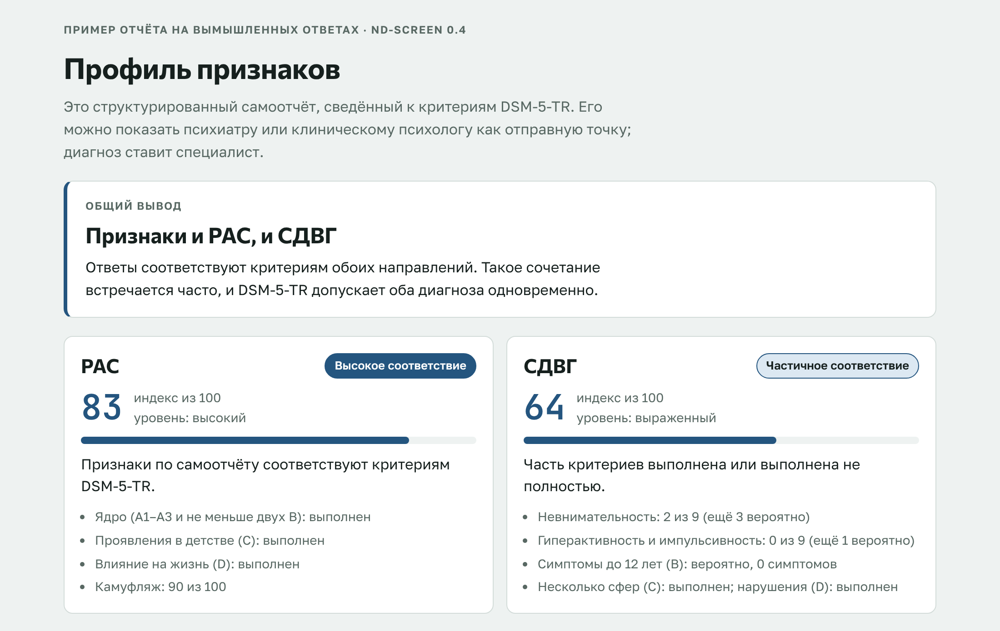
</p>

---

## На чём основаны веса

Да, система опирается на правила подсчёта имеющихся тестов и на структуру критериев DSM-5-TR. Ниже честное разделение: что взято из источников напрямую, а что выбрано рассуждением и требует калибровки.

### Взято из тестов и DSM-5-TR напрямую

| Правило | Источник |
|---|---|
| РАС: все три A + два из четырёх B, раннее начало, нарушения | DSM-5-TR |
| СДВГ: 5 из 9 симптомов для 17+, «часто», несколько симптомов до 12 лет, 2+ обстановки, нарушения | DSM-5-TR |
| Порог 6 симптомов детства | DIVA-5 |
| Часть A ASRS: 6 симптомов, пункты 1–3 от «иногда», 4–6 от «часто», положительно при ≥ 4 | ASRS v1.1, Kessler et al., 2005 |
| Повышенный вес 6 симптомов части A в индексе СДВГ (0.3 ядра) | Они лучше всего отличали СДВГ в исследовании ASRS |
| ASRS 0–4 по частоте, подшкалы 0–36 | ASRS v1.1 |
| RAADS-R: 3 = сейчас и в детстве, 2 = только сейчас, 1 = только в детстве, 0 = никогда; порог 65; подшкалы 31 / 15 / 4 / 16 | Ritvo et al., 2011 |
| AQ: 0/1 за согласие, пороги 32 и 26 | Baron-Cohen et al., 2001; Woodbury-Smith et al., 2005 |
| CAT-Q: 7-балльная шкала, 25–175, три подшкалы | Hull et al., 2019 |
| RBQ-2A: 1–3, две подшкалы | Barrett et al., 2015 |
| Число вопросов в каждой подшкале оригинала (для пересчёта) | Соответствующие публикации |

### Выбрано рассуждением (обосновано, но не откалибровано)

| Параметр | Значение | Почему так |
|---|---|---|
| Пороги «вероятно» и «выполнен» | 0.4 и 0.6 | 0.6 ≈ «в основном да, часто»; 0.4 ≈ «частично, часто». Соответствует тому, как DSM формулирует симптом |
| Доли ядра РАС | 0.45 : 0.30 | A требует всех трёх критериев, B только двух из четырёх, поэтому A весит больше |
| Нарушения и детство в индексе РАС | 0.10 и 0.15 | Это критерии C и D, но индекс прежде всего описывает выраженность ядра |
| Доли индекса СДВГ | 0.6 / 0.2 / 0.2 | Ядро симптомов главное; детство (B) и нарушения (D) одинаково обязательны по DSM |
| Маскировка | до +0.5 оставшегося расстояния | Скрываемый признак не должен давать «нет», но и не должен превращаться в «полностью да» |
| Перевод уровней в AQ/RAADS-R | «в основном» и «полностью» = 1, «частично» = 0.5 | В оригиналах нет середины шкалы, поэтому «частично» считается за половину |
| Пороги согласованности | см. ниже | Подобраны так, чтобы на 300 случайных согласованных профилях было 0 жёстких флагов, а на 300 профилях из случайного шума — 300 |

Все параметры собраны в `ND.PARAMS` и `ND.LEGACY` и могут быть уточнены на данных без изменения логики. Модель подсчёта покрывают **24 622 автоматические проверки** ([`tests/scoring.test.js`](tests/scoring.test.js)): границы значений на 400 случайных профилях, монотонность (сильнее ответ → не ниже балл), опорные профили (нейротипичный, РАС, СДВГ, оба), влияние каждого поля ответа, согласованность.

---

## Отчёт

Отчёт строится сразу в браузере, его можно посмотреть в любой момент, даже не закончив анкету. Есть пример на вымышленном профиле: кнопка «Посмотреть пример отчёта».

**Что в отчёте:**
1. Общий вывод и, если признаки СДВГ выражены, тип СДВГ по DSM-5-TR (комбинированный, преимущественно невнимательный или преимущественно гиперактивно-импульсивный).
2. Карточки РАС и СДВГ: уровень, индекс, статусы критериев, камуфляж, тип проявления.
3. Профиль-радар: 7 критериев РАС и 2 группы симптомов СДВГ, сейчас и в детстве, с кольцами порогов 40 и 60.
4. Согласованность ответов: какие именно ответы противоречат друг другу.
5. Что может помочь: проверенные методики по выраженным признакам.
6. Сильные стороны.
7. Настроение и тревога: баллы PHQ-9 и GAD-7.
8. Алекситимия (PAQ) и аутистическое выгорание (ABSI), если на них отвечали.
9. Сопутствующие состояния с частотой при РАС и СДВГ (только если профиль не нейротипичный).
10. Что стоит учесть: дифференциальные флаги с пояснением.
11. РАС по критериям DSM-5-TR: выраженность сейчас и в детстве, статусы.
12. 18 симптомов СДВГ.
13. Дополнительные черты: камуфляж, внимание к деталям, моторика, эмоциональная регуляция, выгорание.
14. Пересчёт в шкалы оригинальных тестов.
15. Влияние на жизнь по 5 сферам.
16. Ответы своими словами.
17. Пробелы: что не отвечено и что могло бы повысить уверенность.

Кнопки: скопировать сводку текстом, скачать все данные в JSON, печать или PDF, отчёт для специалиста.

**Профиль-радар.** Каждая ось — выраженность от 0 до 100: для РАС по критерию DSM-5-TR, для СДВГ средняя по 9 симптомам группы. Сплошная линия — сейчас, пунктир — детство. Видно форму профиля и что изменилось с детства. На баллы радар не влияет, это другой взгляд на те же числа.

<p align="center">
  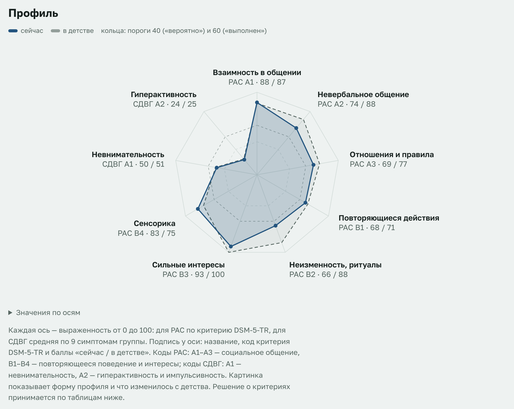
</p>

<p align="center">
  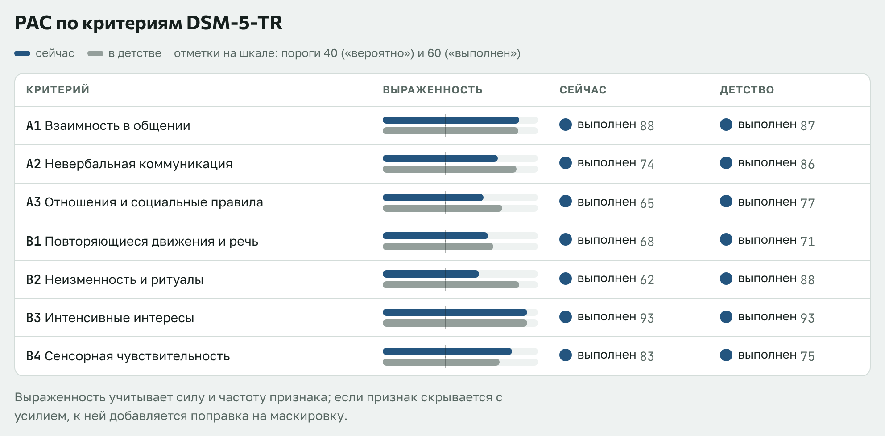
</p>

<p align="center">
  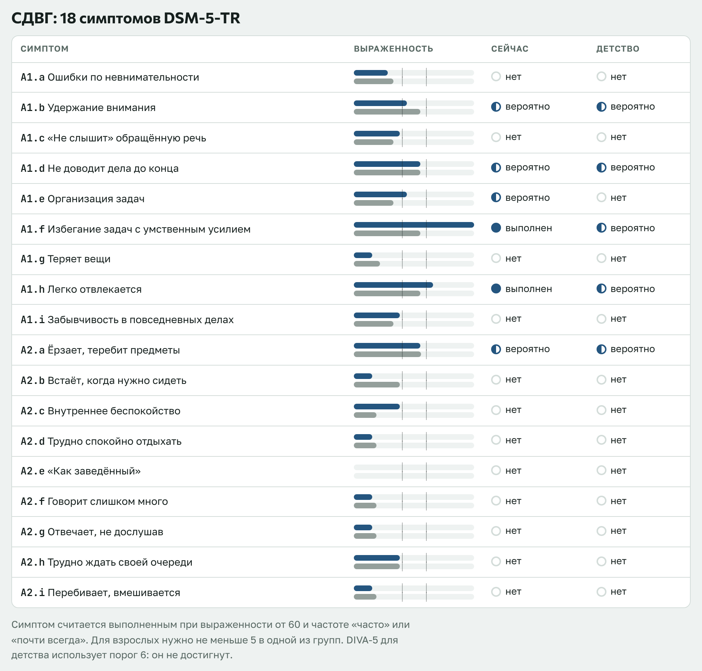
</p>

<p align="center">
  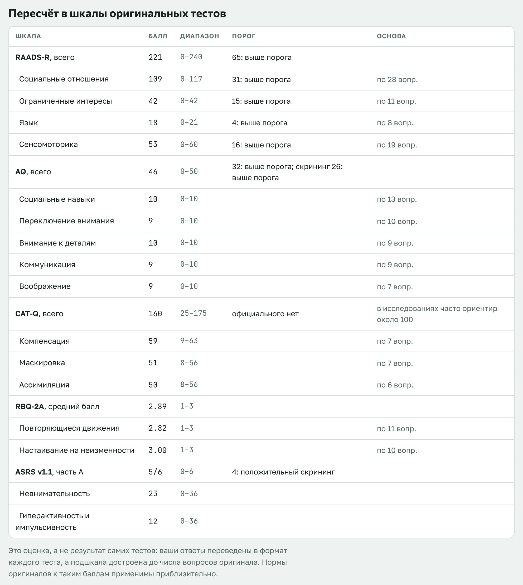
</p>

---

## Отчёт для специалиста

Отдельная страница для психиатра или клинического психолога, которую удобно распечатать или переслать текстом.

- **Сводка:** вывод, индексы, согласованность, камуфляж, баллы шкал, сопутствующие состояния, флаги.
- **РАС по критериям** A1–A3, B1–B4, C, D, E. Под каждым критерием до 4 ответов с наибольшим баллом **со всеми сторонами ответа**: «сейчас: полностью да, часто · детство: в основном да · скрывает с усилием · мешает заметно · где: работа, с незнакомыми».
- **СДВГ:** 18 симптомов сейчас и до 12 лет, ответ на основной вопрос, критерии B–E.
- **Функционирование, пересчёт в шкалы, согласованность.**
- **Что уточнить на интервью:** признаки, которые человек скрывает с усилием; признаки, выраженные сейчас, но не вспомненные из детства (нужен рассказ родителя); признаки, которые появились только во взрослом возрасте; ответы своими словами.
- **Дополнительные шкалы и сопутствующие состояния:** PHQ-9, GAD-7, стороны PAQ и ABSI, отмеченные состояния с данными исследований. При высокой алекситимии у A1 и A2 стоит пометка «Учесть».
- **Сильные стороны** с ответами-основаниями.
- **Предлагаемые следующие шаги:** ADOS-2 (модуль 4), ADI-R, DIVA-5 с информантом, оценка отмеченных состояний.

<p align="center">
  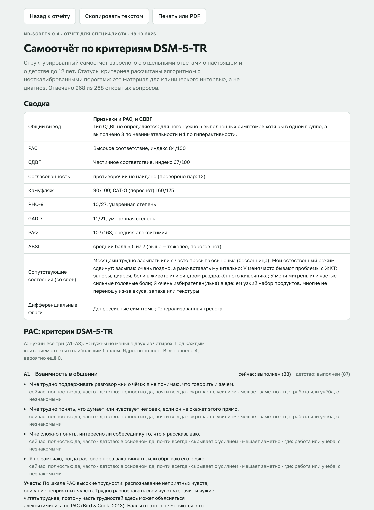
</p>

<p align="center">
  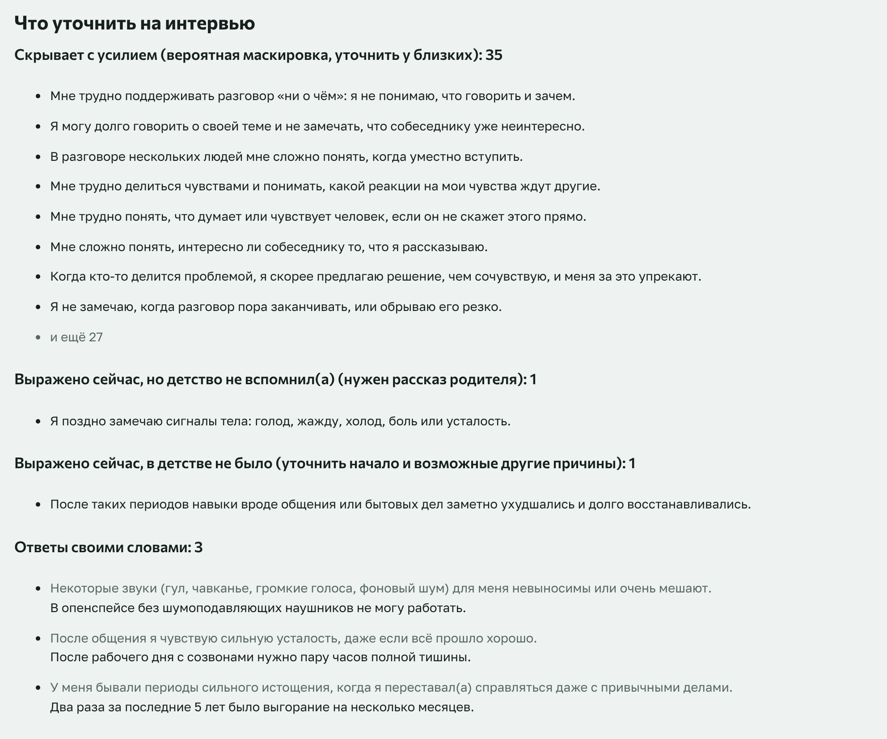
</p>

<p align="center">
  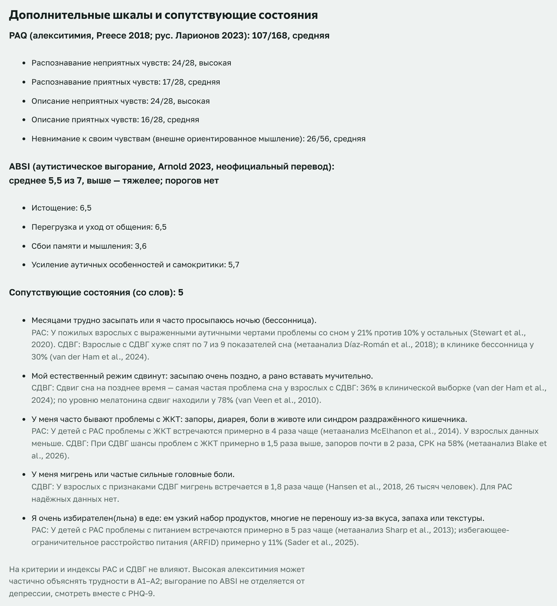
</p>

---

## Проверка согласованности ответов

Самоотчёт уязвим к невнимательности и случайным ответам, поэтому система проверяет себя сама:

| Проверка | Как работает | Жёсткий флаг |
|---|---|---|
| **Пары с противоположным смыслом** | 12 вопросов вида «мне легко…» в пару к «мне трудно…»; противоречие = ответы отличаются от зеркальных на 3+ уровня. Отличие на 4 уровня (например, «полностью да» на оба) считается сильным противоречием | 2+ противоречивые пары |
| **Противоречие внутри ответа** | Убрана в v0.9: при «совсем нет» и «скорее нет» полей «мешает» и «видно ли» больше нет | — |
| **Отдельные вопросы и сферы жизни** | В 3+ вопросах «мешает заметно или сильно», а во всех итоговых вопросах о сферах жизни «не мешали» | никогда, только предупреждение |
| **Маскировка** | В 4+ вопросах об общении «не видно, скрываю с усилием», а блок о маскировке в целом ниже 25 из 100 | никогда, только предупреждение |
| **Однообразие** | > 80% одинаковых ответов | всегда |
| **Скорость** | Медиана < 2 секунд на вопрос | всегда |
| **«Неприменимо»** | 10+ вопросов | только предупреждение |

Разные ответы на вопросы одной темы противоречием не считаются: тема описывает разные проявления, например стимминг и интерес к вращающимся предметам, и у живых людей часть из них бывает, а часть нет. Такая проверка («разброс внутри темы») была до v0.8.1 и убрана, потому что путала участников.

**Какие именно ответы противоречат.** Под каждым предупреждением отчёт показывает сами вопросы с ответами пользователя (сейчас и в детстве), силу противоречия и объяснение, почему эти ответы не сходятся. У каждого вопроса есть кнопка «Изменить ответ»: она открывает этот вопрос, а «Отчёт по текущим ответам» возвращает к пересчитанному отчёту. Те же подробности есть в отчёте для специалиста и в текстовой сводке.

**Степень согласованности** показана одной строкой: сколько сопоставлений ответов проверено и сколько из них противоречат, например «Проверено 23, противоречий 2 (9%, из них сильных 1)».

Проверка **не меняет баллы**: вопросы с противоположным смыслом в баллы не идут и ничего не «гасят». Жёсткий флаг заменяет уровень «высокое соответствие» на «соответствие под вопросом» и прямо пишет в отчёте: **«У вас противоречивые ответы»**. Мягкий флаг: «В ответах есть отдельные противоречия».

<p align="center">
  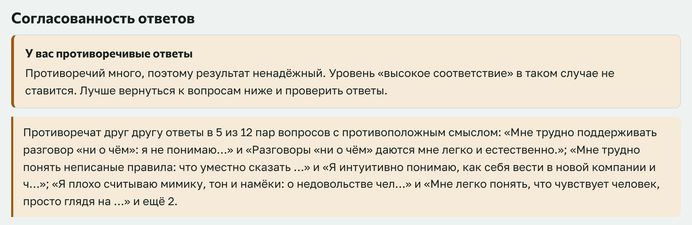
</p>

---

## Сильные стороны

Отдельный раздел из 11 вопросов в 9 направлениях. Направления взяты из тем Aspie-quiz о талантах и из исследований сильных сторон взрослых с РАС и СДВГ. Для каждого выраженного направления отчёт показывает:

- баллы сейчас и в детстве;
- что это направление значит и где оно пригождается;
- как оно связано с РАС или СДВГ, со ссылкой на исследование;
- **обратную сторону**: если та же черта в основной анкете прозвучала как трудность (например, прямота как бестактность или внимание к деталям как перегрузка);
- ответы, на которых держится оценка.

| Направление | Опора |
|---|---|
| Глубокое погружение в интересы | Grove et al., 2018; Sedgwick et al., 2019 |
| Внимание к деталям и точность | Baron-Cohen et al., 2009 |
| Системное и логическое мышление | Baron-Cohen et al., 2009 |
| Память на факты и подробности | Meilleur, Jelenic & Mottron, 2015 |
| Честность и прямота | Russell et al., 2019 |
| Справедливость и надёжность | Russell et al., 2019; темы Aspie-quiz (строгих данных мало, это указано) |
| Нестандартные идеи | White & Shah, 2011; Sedgwick et al., 2019 |
| Энергия и действие в кризисе | Sedgwick et al., 2019 |
| Независимость мышления | De Martino et al., 2008; Izuma et al., 2011 |

Шкала сильных сторон не валидирована, поэтому **на индексы, критерии и проверку согласованности она не влияет**. Это закреплено тестом.

<p align="center">
  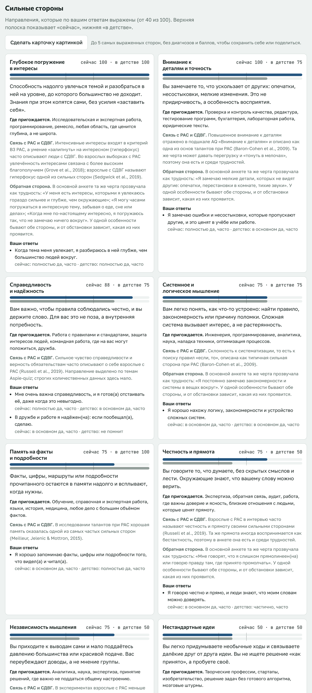
</p>

**Карточка-картинка.** Кнопка «Сделать карточку картинкой» рисует прямо в браузере картинку 1080×1350 с 3–5 самыми выраженными сильными сторонами. На ней нет слов «РАС» и «СДВГ» и нет баллов, только сами стороны и короткое пояснение. Картинку можно скачать или отправить через «Поделиться» на телефоне. Никуда она не отправляется.

<p align="center">
  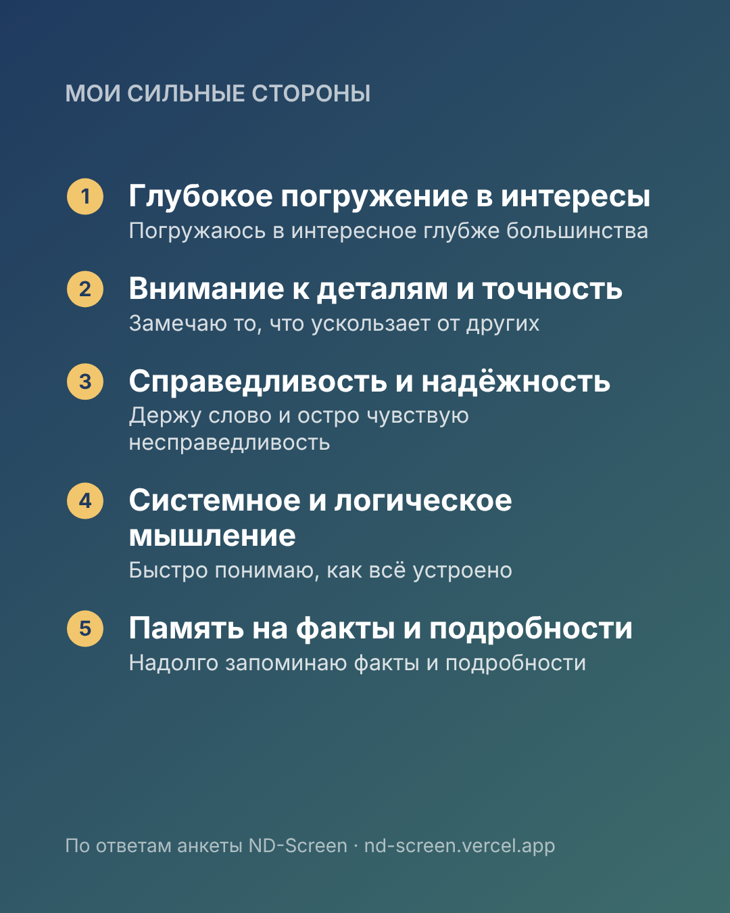
</p>

---

## Почему такой результат

В каждой карточке РАС и СДВГ есть раскрывающийся блок «Почему такой результат», а у каждого критерия и симптома в таблицах — ссылка «почему». Там написано:

- **почему такой статус** и чего не хватает до следующего: «выраженность 47: между 40 и 60, до „выполнен“ не хватает 13» или «выраженность 73 выше 60, но ни в одном ответе нет частоты „часто“, а DSM-5-TR описывает каждый симптом СДВГ словом „часто“»;
- **какие ответы повлияли сильнее всего**;
- **критерии DSM-5-TR** по отдельности: например, какие из A1–A3 не выполнены и сколько B выполнено из двух нужных;
- **почему такой уровень** и что мешает следующему;
- **из чего сложился индекс**: вклад симптомов сейчас, влияния на жизнь и детства в баллах, и ограничение 49, если оно сработало.

Пояснения только читают готовый результат ([`src/explain.js`](src/explain.js)). Тест проверяет, что вклады частей складываются в индекс, а текст совпадает со статусом.

---

## Настроение и тревога: PHQ-9 и GAD-7

Раньше тревога и депрессия проверялись одним вопросом каждая. Теперь вместо них стоят две валидированные шкалы в оригинальной форме: **PHQ-9** (Kroenke et al., 2001) и **GAD-7** (Spitzer et al., 2006). Обе свободны для использования.

- Вопрос задаётся про последние 2 недели, ответы: «ни разу» (0), «несколько дней» (1), «более половины дней» (2), «почти каждый день» (3). Детства и дополнительных полей нет, иначе пороги шкал перестанут работать.
- Балл — сумма: PHQ-9 0–27, GAD-7 0–21. При одном пропущенном пункте сумма пересчитывается пропорционально, при двух и больше балла нет. Степень: 0–4 минимальная, 5–9 лёгкая, 10–14 умеренная, 15–19 умеренно тяжёлая (PHQ-9) или выраженная (GAD-7, от 15), 20–27 тяжёлая (PHQ-9).
- От 10 баллов в отчёте появляется флаг тревоги или депрессии, тема «Тревога и подавленность» в блоке «Что может помочь» и строка в отчёте для специалиста.
- **9-й пункт PHQ-9** спрашивает о мыслях о смерти или самоповреждении. При любом ответе, кроме «ни разу», сразу под вопросом и вверху отчёта показывается блок помощи с номером 112, а отчёт для специалиста отмечает, что нужна оценка риска.
- **На РАС и СДВГ шкалы не влияют**: в критерии, индексы, проверку согласованности и пересчёт в тесты они не входят. Это проверяет тест на 80 случайных профилях.

<p align="center">
  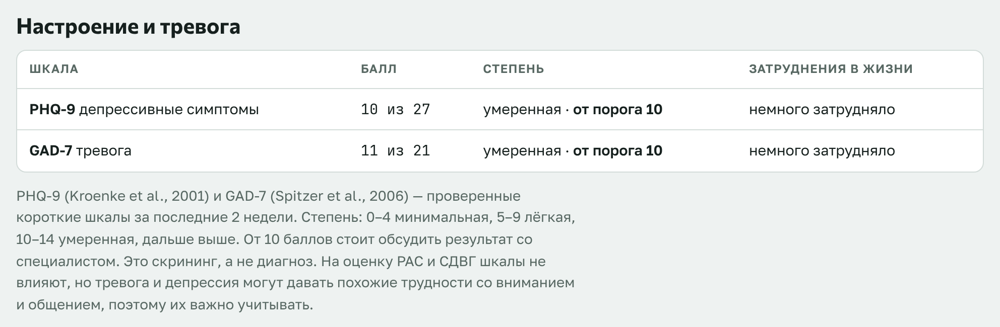
</p>

---

## Алекситимия: PAQ

Алекситимия означает трудность с распознаванием и описанием своих чувств. Это не признак РАС, но она встречается примерно у половины аутичных взрослых и примерно у 5% остальных (Kinnaird et al., 2019). Она сама по себе затрудняет понимание эмоций, и своих, и чужих. Поэтому часть трудностей в эмоциональной взаимности и невербальном общении (A1, A2) может объясняться ею, а не РАС (Bird & Cook, 2013). Это главная известная ловушка в скрининге РАС.

- **Шкала** — Perth Alexithymia Questionnaire (PAQ, Preece et al., 2018), 24 утверждения, согласие от 1 до 7, подписаны только 1, 4 и 7, как в оригинале. Использование разрешено авторами без ограничений.
- **Русская версия** — Ларионов и соавт., 2023 (*Клиническая и специальная психология*), 229 взрослых, надёжность α = 0,95. Тексты утверждений взяты оттуда без изменений.
- **Балл** — сумма 24–168 и пять подшкал по ключу: распознавание неприятных и приятных чувств, их описание, невнимание к своим чувствам. Уровни «низкая / средняя / высокая» — по нормам руководства PAQ для взрослых (высокая от 113). В русской выборке средний балл ниже (64,7), это указано в отчёте. При одном пропуске сумма пересчитывается пропорционально.
- **Что меняется в отчёте.** При высокой алекситимии (или высоких трудностях распознавания и описания чувств) появляется флаг «Алекситимия», а в «почему» у A1 и A2 строчка о том, что часть трудностей может объясняться ею. **Баллы РАС и СДВГ не меняются.**

<p align="center">
  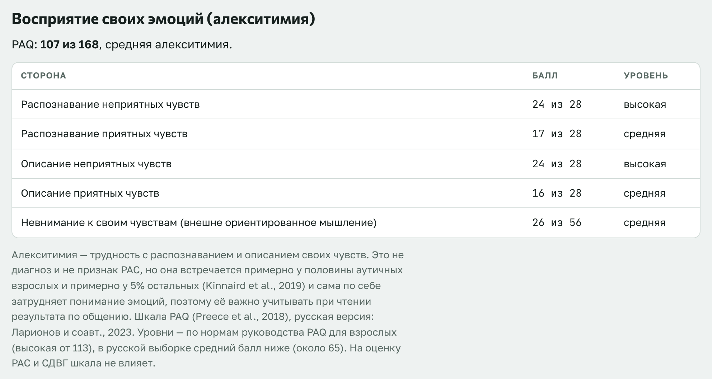
</p>

---

## Аутистическое выгорание: ABSI

Аутистическое выгорание — долгий период сильного истощения, когда то, что раньше давалось, становится недоступным, а переносимость шума, людей и нагрузок падает.

- **Вход.** Сначала один вопрос: было ли такое состояние сейчас или раньше. На «нет» остальные 20 вопросов не показываются.
- **Шкала** — Autistic Burnout Severity Items (ABSI, Arnold et al., 2023, журнал *Autism*): 20 утверждений о последнем или нынешнем периоде выгорания, согласие от 1 до 7. В статье шкала развёрнута (1 — совершенно согласен), у нас 7 — совершенно согласен, поэтому выше — тяжелее.
- **Балл**, как в статье, — среднее по отвеченным пунктам. При пропуске больше двух пунктов балла нет. Показаны 4 стороны выгорания: истощение, перегрузка и уход от общения, сбои памяти и мышления, усиление аутичных особенностей и самокритики. Авторы советуют смотреть их по отдельности.
- **Порогов у шкалы нет**, поэтому флагов она не даёт. Для сравнения показано среднее у аутичных участников исследования (около 6,1 по нашей шкале).
- **Честно о пределах.** Надёжно отличить выгорание от депрессии пока не может ни одна шкала: в исследовании ABSI заметно связана с PHQ-9. Поэтому блок стоит рядом с PHQ-9, а не вместо него. Русской версии нет, перевод наш и неофициальный.
- На баллы РАС и СДВГ шкала не влияет.

<p align="center">
  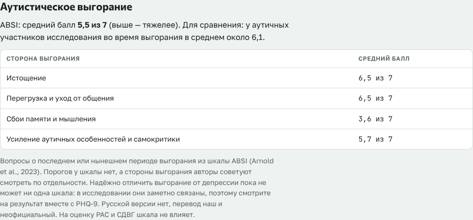
</p>

---

## Сопутствующие состояния

17 вопросов с ответом «да / нет» о состояниях, которые при РАС и СДВГ встречаются чаще, чем в среднем. Они не доказывают ни РАС, ни СДВГ и **ни на что не влияют**: ни на баллы, ни на флаги, ни на проверку согласованности. В отчёте отмеченные состояния показываются, только если профиль не нейротипичный, с частотой и источником.

| Состояние | Что известно | Источник |
|---|---|---|
| Бессонница | РАС: 21% против 10% (взрослые с выраженными чертами). СДВГ: хуже по 7 из 9 показателей сна, бессонница у 30% в клинике | Stewart et al., 2020; Díaz-Román et al., 2018; van der Ham et al., 2024 |
| Поздний режим сна | СДВГ: 36% в клинике, сдвиг мелатонина до 78% | van der Ham et al., 2024; van Veen et al., 2010 |
| Проблемы с ЖКТ | РАС: примерно в 4 раза чаще (дети). СДВГ: в 1,5 раза, запоры почти в 2 раза | McElhanon et al., 2014; Blake et al., 2026 |
| Гипермобильность суставов | 51% нейроотличных взрослых против около 20% | Csecs et al., 2022 |
| Мигрень | СДВГ: в 1,8 раза чаще | Hansen et al., 2018 |
| Эпилепсия | РАС: около 12% | Lukmanji et al., 2019 |
| Астма, экзема, аллергия | СДВГ: астма в 1,8 раза, экзема в 1,4 раза (дети). РАС: экзема в 1,5 раза, с астмой связи нет | Miyazaki et al., 2017; Tsai et al., 2020; Zheng et al., 2016 |
| Лишний вес | СДВГ: в 1,55 раза чаще у взрослых | Cortese et al., 2016 |
| Беспокойные ноги | СДВГ: 20–33% взрослых против 3–15% | Migueis et al., 2023 |
| Дислексия, дискалькулия | СДВГ: в 3–4 раза чаще (школьники) | Visser et al., 2020 |
| Тики | СДВГ у 55% людей с синдромом Туретта. РАС: тики у 9–11% (небольшие исследования) | Freeman, 2007; Simonoff et al., 2008; Canitano & Vivanti, 2007 |
| Избирательность в еде | РАС: проблемы с питанием в 5 раз чаще (дети), ARFID около 11% | Sharp et al., 2013; Sader et al., 2025 |
| Синестезия | РАС: 19% против 7% | Baron-Cohen et al., 2013 |
| Хроническая боль, фибромиалгия | СДВГ у 25–45% людей с фибромиалгией против 3–7% | Kasahara et al., 2026 |

У каждого состояния в отчёте указана надёжность данных. Часть цифр получена у детей или в клинических выборках, это тоже указано.

<p align="center">
  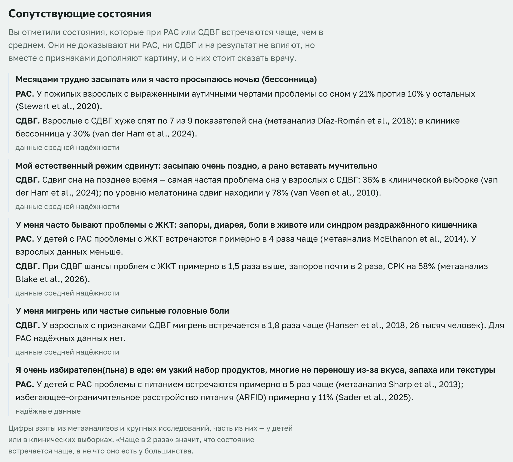
</p>

---

## Что может помочь

Блок подбирает методики и приспособления по признакам, которые у человека выражены (уровень «вероятно» и выше). Например, внимание и откладывание дел, беспокойство и импульсивность, эмоции, сенсорика, сигналы тела, общение, перемены, выгорание и маскировка, тревога и подавленность, сон. Всего 10 тем и 21 совет, плюс 2 общих шага для всех, у кого есть признаки. Правила подбора лежат в [`src/support.js`](src/support.js). На баллы, критерии и вывод блок не влияет, и это проверяет тест.

У каждого совета указан **уровень доказательности** и **источник**:

| Метка | Что значит | Примеры |
|---|---|---|
| В клинических рекомендациях | Входит в рекомендации NICE и других профессиональных руководств | КПТ для взрослых с СДВГ, изменения среды (NICE NG87); групповые программы социальных навыков, поддержка трудоустройства, адаптированная КПТ (NICE CG142); КПТ бессонницы (европейские рекомендации, Riemann et al., 2017) |
| Проверено в контролируемых испытаниях | Рандомизированные испытания или их метаанализы | Safren et al., 2010; Solanto et al., 2010; Cortese et al., 2018; Laugeson et al., 2015 (PEERS); Quadt et al., 2021 (интероцептивная тренировка); Weston et al., 2016 |
| Основано на исследованиях опыта, испытаний мало | Исследования опыта аутичных взрослых и клиническая практика | восстановление после перегрузки и выгорания (Raymaker et al., 2020), шумоподавляющие наушники |

Отдельно, свёрнутым списком, показано то, что **часто советуют, но польза не доказана**: утяжелённые одеяла, исключающие диеты, хелирование, компьютерные тренажёры памяти и нейрофидбек при СДВГ. У каждого пункта тоже есть источник.

Лекарства упоминаются только как «обсудить с психиатром»: блок не называет препараты и дозы.

<p align="center">
  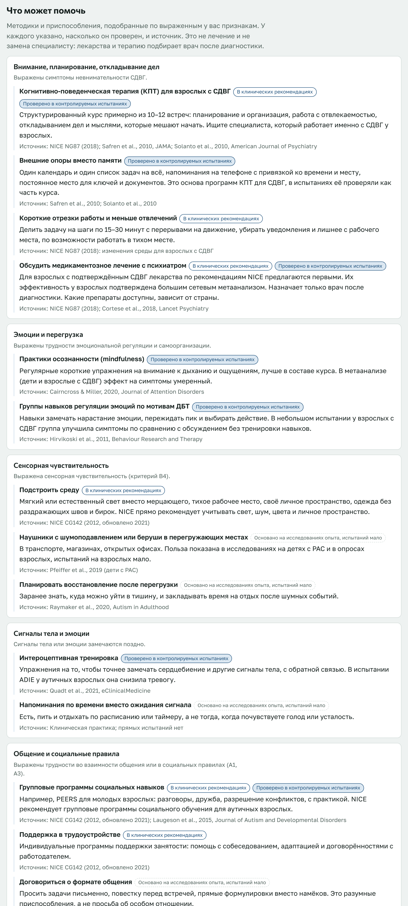
</p>

---

## Покрытие оригинальных тестов

Сколько вопросов ND-Screen относится по смыслу к каждой подшкале оригинала. Один вопрос может относиться к нескольким подшкалам. При пересчёте средний балл по вопросам умножается на число вопросов оригинала.

| Тест | Подшкала | Вопросов в оригинале | Вопросов ND-Screen |
|---|---|---:|---:|
| RAADS-R | Социальные отношения | 39 | 28 |
| | Ограниченные интересы | 14 | 11 |
| | Язык | 7 | 8 |
| | Сенсомоторика | 20 | 19 |
| AQ | Социальные навыки | 10 | 13 |
| | Переключение внимания | 10 | 10 |
| | Внимание к деталям | 10 | 9 |
| | Коммуникация | 10 | 9 |
| | Воображение | 10 | 7 |
| CAT-Q | Компенсация | 9 | 7 |
| | Маскировка | 8 | 7 |
| | Ассимиляция | 8 | 6 |
| RBQ-2A | Повторяющиеся движения | 12 | 11 |
| | Настаивание на неизменности | 8 | 10 |
| ASRS v1.1 | 18 симптомов DSM | 18 | 36 (по 2 на симптом) |

Если уточняющий вопрос закрыт (признак в теме слабый), при пересчёте он получает средний балл основных вопросов той же темы. Так закрытые вопросы не завышают и не занижают результат.

---

## Ограничения

ND-Screen — честный эксперимент, и у него есть пределы:

- **Не диагноз.** Диагноз ставит специалист по клиническому интервью и наблюдению. ADOS-2 и ADI-R нельзя заменить анкетой.
- **Не валидирован.** Веса и пороги обоснованы, но не проверены на людях с подтверждённым диагнозом. Чувствительность и специфичность неизвестны.
- **Пересчёт в оригинальные шкалы приблизительный.** Вопросы собственные, а «детство» здесь до 12 лет (в RAADS-R до 16). Нормы оригиналов к пересчитанным баллам применимы с осторожностью.
- **Самоотчёт о детстве** зависит от памяти. Сильнее всего его дополняет рассказ родителя или человека, знавшего вас в детстве.
- **Дифференциальные флаги** — это подсказка обсудить состояние. Тревога, депрессия и алекситимия проверяются валидированными шкалами PHQ-9, GAD-7 и PAQ, но и это скрининг, а не диагноз; остальные флаги (социальная тревожность, травма, колебания настроения, сон) — по одному вопросу.
- **ABSI** переведена нами неофициально и не имеет порогов; отличить выгорание от депрессии она не может.
- **Только для взрослых** (17+).

---

## Приватность

Анкета — статический сайт без сервера и без аналитики. Ответы хранятся только в `localStorage` вашего браузера и никуда не отправляются. Экспорт в JSON и печать делаются локально. Кнопка «Начать заново» удаляет все ответы.

---

## Устройство проекта

Чистый JavaScript без фреймворков и без сборщика зависимостей.

```
src/
  items.js       банк вопросов: разделы, конструкты DSM, симптомы СДВГ, сферы жизни,
                 флаги, сильные стороны, правило адаптивности ND.eligible
  hints.js       пояснения «Что имеется в виду» к каждому вопросу
  scoring.js     подсчёт: L1 балл вопроса → L2 критерий → L3 DSM, пересчёт в тесты,
                 согласованность → L4 уровни, индексы, общий вывод
  clinician.js   отчёт для специалиста
  support.js     «Что может помочь»: методики, уровни доказательности, источники
  explain.js     «Почему такой результат»: пояснения к статусам, критериям, уровню, индексу
  insights.js    раннее развитие и семья, бюджет энергии, карта масок (на баллы не влияют)
  lab.js         «Лаборатория»: пробы «где были мысли», «сейчас или потом», время реакции, интервалы, нагрузка, Навон (на баллы не влияет)
  sprite.js      пиксельный персонаж 32×32 и подсказки предметов
  music.js       тихая чиптюн-музыка (Web Audio)
  pixels.js      пиксельные картинки в 4 темах и кадры анимации (генерируется tools/pixelart.py)
  app.js         интерфейс: вступление, вопросы, отчёт
  sample.js      вымышленный профиль для примера отчёта
  style.css      стили, светлая и тёмная тема, печать
tests/
  scoring.test.js  24 622 проверки подсчёта
tools/
  pixelart.py    рисует пиксельные сцены и пишет src/pixels.js
docs/
  spec.md        спецификация с историей изменений
  screenshots/   скриншоты для README
build.py         собирает dist/ (сайт) и artifact/ (превью) из src/
vercel.json      Vercel отдаёт папку dist/
```

**Запуск локально**

```bash
python3 build.py                 # собрать dist/
python3 -m http.server -d dist   # открыть http://localhost:8000
```

**Тесты**

```bash
node tests/scoring.test.js
```

**Деплой.** Vercel → Add New → Project → Import этого репозитория. `vercel.json` уже указывает папку `dist`.

---

## Источники

- American Psychiatric Association. *DSM-5-TR*, 2022.
- Ritvo R. A. et al. The Ritvo Autism Asperger Diagnostic Scale-Revised (RAADS-R). *J Autism Dev Disord*, 2011.
- Baron-Cohen S. et al. The Autism-Spectrum Quotient (AQ). *J Autism Dev Disord*, 2001.
- Woodbury-Smith M. R. et al. Screening adults for Asperger syndrome using the AQ. *J Autism Dev Disord*, 2005.
- Hull L. et al. Development and validation of the Camouflaging Autistic Traits Questionnaire (CAT-Q). *J Autism Dev Disord*, 2019.
- Kessler R. C. et al. The World Health Organization Adult ADHD Self-Report Scale (ASRS). *Psychol Med*, 2005.
- Barrett S. L. et al. Assessing subtypes of restricted and repetitive behaviour using the Adult Repetitive Behaviour Questionnaire-2 (RBQ-2A). *J Autism Dev Disord*, 2015.
- Kroenke K., Spitzer R. L., Williams J. B. W. The PHQ-9: validity of a brief depression severity measure. *J Gen Intern Med*, 2001.
- Spitzer R. L., Kroenke K., Williams J. B. W., Löwe B. A brief measure for assessing generalized anxiety disorder: the GAD-7. *Arch Intern Med*, 2006.
- Preece D. et al. The Perth Alexithymia Questionnaire: development and initial validation. *Pers Individ Dif*, 2018.
- Ларионов П. и соавт. Русская версия Пертского опросника алекситимии (PAQ). *Клиническая и специальная психология*, 2023, 12(1).
- Kinnaird E., Stewart C., Tchanturia K. Investigating alexithymia in autism: a systematic review and meta-analysis. *Eur Psychiatry*, 2019.
- Bird G., Cook R. Mixed emotions: the contribution of alexithymia to the emotional symptoms of autism. *Transl Psychiatry*, 2013.
- Arnold S. R. C. et al. Towards the measurement of autistic burnout. *Autism*, 2023.
- Источники частоты сопутствующих состояний — в таблице раздела «Сопутствующие состояния».
- Lord C. et al. *ADOS-2*, 2012. Rutter M., Le Couteur A., Lord C. *ADI-R*, 2003. Kooij J. J. S. et al. *DIVA-5*, 2019.
- Baron-Cohen S. et al. Talent in autism: hyper-systemizing, hyper-attention to detail and sensory hypersensitivity. *Phil Trans R Soc B*, 2009.
- Meilleur A.-A. S., Jelenic P., Mottron L. Prevalence of clinically and empirically defined talents and strengths in autism. *J Autism Dev Disord*, 2015.
- Grove R. et al. Special interests and subjective wellbeing in autistic adults. *Autism Research*, 2018.
- Russell G. et al. Mapping the autistic advantage from the accounts of adults diagnosed with autism. *Autism in Adulthood*, 2019.
- Sedgwick J. A., Merwood A., Asherson P. The positive aspects of ADHD: a qualitative investigation of successful adults with ADHD. *ADHD Atten Def Hyp Disord*, 2019.
- White H. A., Shah P. Creative style and achievement in adults with ADHD. *Pers Individ Dif*, 2011.
- De Martino B. et al. Explaining enhanced logical consistency during decision making in autism. *J Neurosci*, 2008.
- Izuma K. et al. Insensitivity to social reputation in autism. *PNAS*, 2011.

---

<sub>ND-Screen 0.4 · экспериментальный проект · формулировки вопросов собственные, по конструктам DSM-5-TR</sub>
